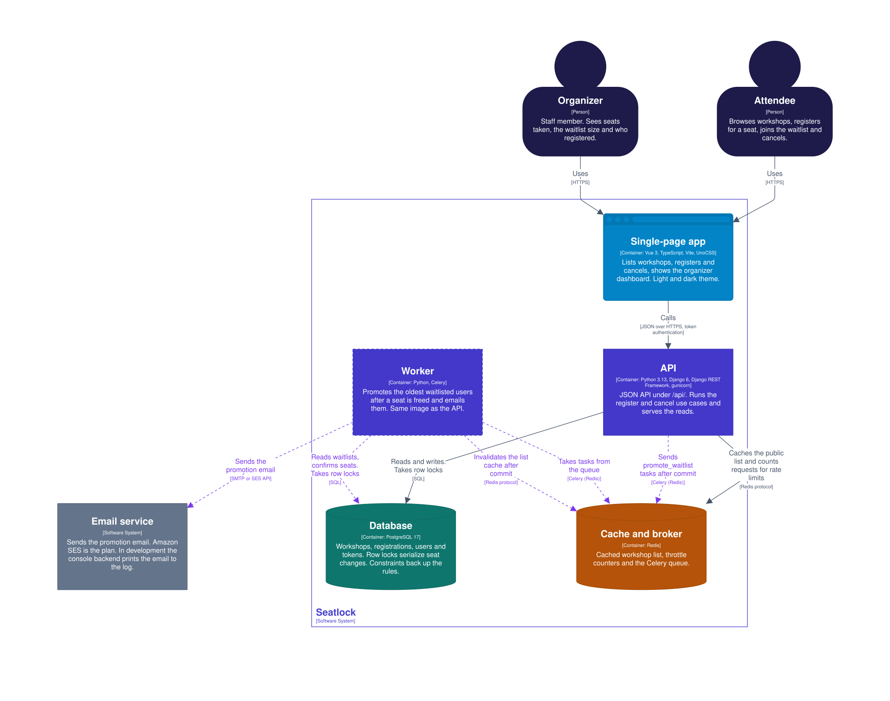

# Seatlock

Workshops and classes with limited seats - built so a seat can never be sold twice.

**Stack:** Django 6 · Django REST Framework · PostgreSQL · Celery + Redis · Vue 3 (Vite, TypeScript) · Docker Compose · GitHub Actions

## Why it's interesting

- **No overselling under concurrency.** Registration locks the workshop row (`SELECT ... FOR UPDATE`) inside a transaction, so simultaneous requests are serialized. A test fires 20 threads at a 5-seat workshop and asserts exactly 5 confirmed and 15 waitlisted. A load test sends 200 simultaneous HTTP requests for 10 seats to a real gunicorn: exactly 10 are confirmed in 8 of 8 runs, while the same test on code without the lock confirmed up to 24 ([results](docs/load-test.md)).
- **Database-level guarantees.** Check and partial unique constraints enforce positive capacity and one active registration per user per workshop, even if application code is bypassed.
- **Waitlist with async promotion.** Cancelling a confirmed seat schedules a Celery task via `transaction.on_commit`, which promotes the oldest waitlisted person and emails them.
- **Idempotent registration.** Retrying the same request returns the existing registration.
- **Clean architecture around the seat rules.** The backend has four layers: domain, application, infrastructure and interface. Dependencies point inward. The seat rules are plain Python with no Django, so 35 tests run in about 0.1 s without a database, and a test fails the build on a forbidden import. The lock order, the after-commit side effects and the rollback behavior are tested with in-memory fakes. This was first an experiment (`exp/clean-arch-*`) and is now adopted: see [ADR 0005](docs/adr/0005-clean-architecture-experiment.md) for the evidence and the cost.

## Run it

```bash
docker compose up --build
```

| Service  | URL                                |
|----------|------------------------------------|
| Frontend | http://localhost:5173              |
| API      | http://localhost:8000/api/workshops/ |
| Admin    | http://localhost:8000/admin/       |

```bash
docker compose exec web python manage.py createsuperuser
docker compose run --rm web pytest      # tests run against real Postgres
docker compose run --rm web ruff check .
```

## Layout

```
backend/    Django project (config/) and four layers: domain, application, infrastructure, interface
frontend/   Vue 3 + Vite + TypeScript, styled with UnoCSS (ADR 0006)
compose.yaml  db, redis, web, worker, frontend
```

Business rules live in `backend/domain/` (seat decisions) and `backend/application/` (use cases), never in views, so they are easy to test without a database. See [docs/architecture.md](docs/architecture.md) for the layers, the request flows and the diagrams, and [ADR 0005](docs/adr/0005-clean-architecture-experiment.md) for the decision.

## Architecture diagrams

The architecture is drawn as a [C4 model](https://c4model.com/) with [Structurizr](https://docs.structurizr.com/). There are 23 views: system context, containers, the components of the app, the API and the worker, five request flows, and four deployments (Docker Compose, the AWS demo, AWS production and the CI load test), drawn with AWS service icons. Components are colored by layer, so the dependency rule can be read from the picture.



All the views, with what each one shows, are in [docs/architecture/](docs/architecture/README.md).

### Start Structurizr

This opens the diagrams in the interactive viewer, with pan, zoom, documentation pages and a link from each component to its code:

```bash
docker run --rm -p 8080:8080 -v "$PWD/docs/architecture":/usr/local/structurizr \
  structurizr/structurizr:2026.09.19 local
```

Then open <http://localhost:8080>. The viewer needs Docker and internet access, because it downloads the AWS icon theme for the deployment views from GitHub when it starts. It does not need the rest of the stack, and port 8080 does not clash with it.

Structurizr Lite was the tool this workspace was planned for. Its `structurizr/lite` image is now only a stub: it prints a deprecation notice and exits. The `local` command above is its maintained successor. It reads the same files and uses the same folder and port.

The first start writes `workspace.json` and `.structurizr/` in `docs/architecture/`. Git ignores both.

To change a diagram, edit the DSL files in `docs/architecture/`, then redraw the images with `docs/architecture/export.sh`. The steps are in the [folder README](docs/architecture/README.md#change-the-diagrams).

## Documentation

- [Backend architecture](docs/architecture.md): layers, request flows, concurrency, data model and testing, with diagrams
- [C4 architecture diagrams](docs/architecture/README.md): context, containers, components, request flows and four deployments, built with Structurizr (see [how to start it](#start-structurizr))
- [Load test](docs/load-test.md): 200 simultaneous registrations for 10 seats, with a control run that removes the lock
- [ADRs](docs/adr/): row locks (0001), tasks on commit (0002), AWS target (0003), CDK (0004), clean architecture (0005), frontend styling (0006)
- [Deploy and rollback](docs/deploy.md), [SLOs](docs/slo.md) and [runbooks](docs/runbooks/)

## Rejected alternative

A lighter variant of the architecture, `exp/clean-arch-lite`, was tried and **not** adopted. It moves only the seat decisions into plain functions in `backend/workshops/rules.py` and leaves the locking in `services.py`. Its code is kept at the tag [`archive/clean-arch-lite`](https://github.com/massimoselvi/seatlock/tree/archive/clean-arch-lite).

The comparison, including a test that shows what the lighter variant misses, is in [ADR 0005](docs/adr/0005-clean-architecture-experiment.md).

## Roadmap

- [x] Models, constraints, seat allocation service, waitlist promotion task
- [x] Read-only workshops API, Vue list page, CI
- [x] Clean architecture for the backend ([ADR 0005](docs/adr/0005-clean-architecture-experiment.md))
- [x] Auth, register/cancel API endpoints and UI
- [x] Organizer dashboard
- [x] Rate limiting and caching on the public list
- [ ] Deployment (AWS): the CDK stack and the deploy guide are written, but not yet run against a real account
