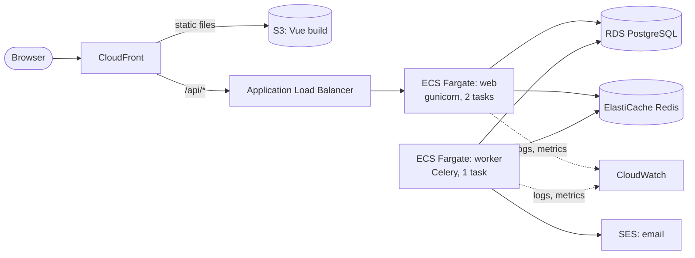

# 0003. Target AWS architecture

Status: Accepted

## Context

Seatlock runs on Docker Compose today: Django (gunicorn), a Celery worker, PostgreSQL, Redis and a Vue single-page app.
We need a production target that is cheap to run for a small workload, safe for the seat-locking rules, and easy to explain.

Constraints from earlier decisions:

- Seat allocation uses Postgres row locks ([ADR 0001](0001-row-locks-for-seat-allocation.md)). The database must be a real PostgreSQL, reached through direct connections or a pooler in session mode.
- Tasks are enqueued on commit ([ADR 0002](0002-enqueue-celery-tasks-on-commit.md)). The broker is Redis.
- The code also uses Redis as the cache and for throttle counters.

## Decision

Run in one region (`eu-west-1`) with managed services and no servers to patch.

| Part | Choice | Why |
|------|--------|-----|
| Compute | ECS on Fargate, one service for `web`, one for `worker` | Same container image as Compose. No hosts to manage. |
| Database | RDS PostgreSQL 17, Multi-AZ in production | Row locks need real Postgres. Automated backups and failover. |
| Cache and broker | ElastiCache for Redis | The code already speaks Redis. No application change. |
| Entry | CloudFront in front of an ALB, with the SPA in S3 | One domain, TLS, caching of static files. `/api/*` goes to the ALB. |
| Email | SES | Waitlist promotion emails. |
| Secrets | Secrets Manager, injected as task secrets | Nothing sensitive in the image or in environment files. |
| Logs and alarms | CloudWatch | Alarms from [the SLO document](../slo.md). |
| Network | One VPC, tasks and data in private subnets | Only the ALB is public. |

## Alternatives

- **Lambda with API Gateway.** It scales to zero, but database connections and long-lived Celery workers fit badly. Connection limits on RDS need a proxy.
- **App Runner.** Simpler than ECS, but it has no worker service and little network control.
- **EKS.** Too much to run for one small application.
- **SQS instead of Redis for Celery.** SQS is more durable, but it needs a broker change and does not replace the cache. We keep Redis for now. If we need stronger delivery, add a periodic sweep first (see ADR 0002), then reconsider SQS.
- **EC2 with Docker Compose.** Cheapest on paper, but we own patching, backups and failover.

## Consequences

- The application needs no code change to deploy, only configuration (`DATABASE_URL`, `CELERY_BROKER_URL`, `CACHE_URL`).
- Redis is a single point of failure for throttling, cache and tasks. Throttle and cache errors must not break reads. A replica gives failover.
- Fargate tasks in private subnets need a NAT gateway or VPC endpoints to reach ECR, Secrets Manager and SES. NAT is the largest fixed cost after compute.

## Failure modes

| Failure | Effect | Mitigation |
|---------|--------|------------|
| One web task dies | Capacity drops | ALB health check, ECS replaces it, minimum 2 tasks |
| Worker down | Waitlist not promoted | Queue backlog alarm, restart. See the [runbook](../runbooks/queue-backlog.md). |
| Database failover | About 1 to 2 minutes of errors | Multi-AZ, retry on the client |
| Redis down | Cache and throttle fail, tasks wait | Replica, graceful fallback on cache errors |
| Bad deploy | Errors rise | Rolling deploy with circuit breaker, rollback to the previous task definition |

## Monthly cost

Details, assumptions and sources: [cost analysis](../cost-analysis.md). Prices are `eu-west-1`, on demand, USD, from the AWS Price List API (2026-10-20).

| Setup | Low traffic | Expected | High |
|-------|-------------|----------|------|
| Demo (1 AZ, no NAT) | 113 | 116 | 177 |
| Demo lean (1 web task, ARM) | 86 | 89 | 150 |
| Production-like (Multi-AZ, NAT, Redis replica) | 169 | 172 | 234 |

- About 95% of the cost is fixed at expected traffic. CloudFront's free tier covers the first 10 million requests a month. The high case (40 million) adds about 65.
- Public IPv4 addresses cost 0.005 a hour each. They are 16% of the demo bill. The first version of this table left them out.
- A NAT gateway (38.69 a month) is cheaper than the four VPC endpoints that would replace it (64.24).
- WAF adds about 10 a month at expected traffic.

The demo trades safety for cost: tasks sit in public subnets with tight security groups and the database is single AZ.
Do not run the demo setup with real user data.
