# Backend architecture

How the Seatlock backend is built, why, and where new code goes.
The decision is in [ADR 0005](adr/0005-clean-architecture-experiment.md). The two rules it protects are in [ADR 0001](adr/0001-row-locks-for-seat-allocation.md) (row locks) and [ADR 0002](adr/0002-enqueue-celery-tasks-on-commit.md) (tasks on commit).
The diagrams use [Mermaid](https://mermaid.js.org/). GitHub and most editors render them.

This document covers the backend. The Vue frontend talks to it only through the JSON API.

## Contents

1. [The goal in one paragraph](#1-the-goal-in-one-paragraph)
2. [Runtime components](#2-runtime-components)
3. [The four layers](#3-the-four-layers)
4. [Directory map](#4-directory-map)
5. [The domain model](#5-the-domain-model)
6. [Ports and adapters](#6-ports-and-adapters)
7. [Flow: register for a workshop](#7-flow-register-for-a-workshop)
8. [Flow: cancel and promote the waitlist](#8-flow-cancel-and-promote-the-waitlist)
9. [Concurrency: the last seat](#9-concurrency-the-last-seat)
10. [Data model](#10-data-model)
11. [The read side and the cache](#11-the-read-side-and-the-cache)
12. [HTTP: errors, auth and rate limits](#12-http-errors-auth-and-rate-limits)
13. [Testing strategy](#13-testing-strategy)
14. [Where does new code go?](#14-where-does-new-code-go)
15. [Recipes](#15-recipes)
16. [Known bypasses and gaps](#16-known-bypasses-and-gaps)
17. [Glossary](#17-glossary)

## 1. The goal in one paragraph

A workshop has a fixed number of seats, and a seat must never be sold twice. Two requests can arrive at the same moment for the last seat. The design makes that case safe, and it makes the safety easy to test.
Business rules live in plain Python with no framework. A small set of interfaces (ports) separates those rules from Django, PostgreSQL, Redis, Celery and email. Everything framework-specific sits at the edge.

## 2. Runtime components

This is what `docker compose up` starts.

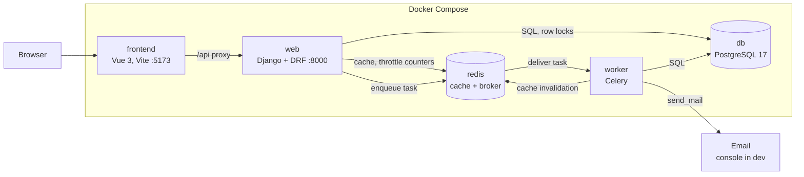

| Component | Role |
|-----------|------|
| `web` | Serves `/api/`. Runs the register and cancel use cases. |
| `worker` | Runs the `promote_waitlist` task after a seat is freed. |
| `db` | The single source of truth. Row locks serialize seat changes here. |
| `redis` | Cache for the public list, rate-limit counters and the Celery broker. |

The AWS target is described in [ADR 0003](adr/0003-target-aws-architecture.md).

## 3. The four layers

Dependencies point **inward**. An arrow below means "imports".

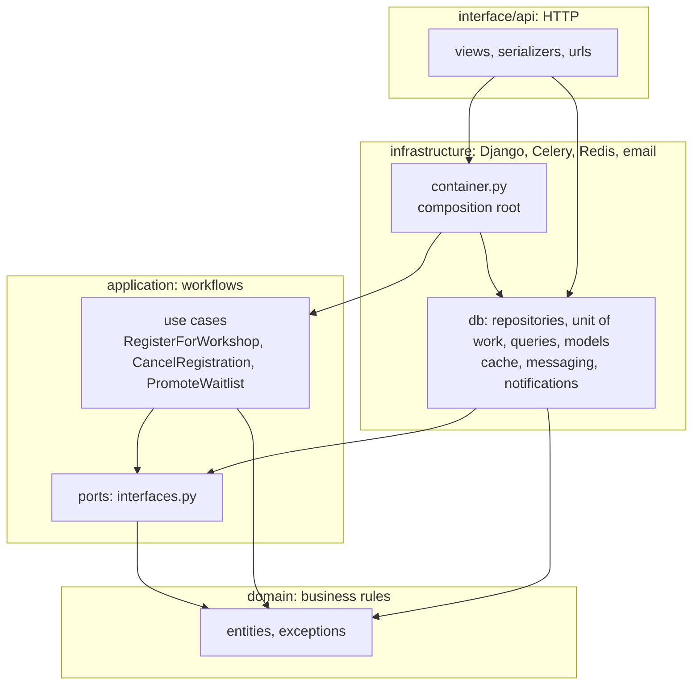

| Layer | Holds | May import | Must not import |
|-------|-------|------------|-----------------|
| `domain` | Seat rules, status changes, domain errors | standard library | Django, DRF, Celery, any other layer |
| `application` | Use cases, ports, result DTOs | `domain` | Django, DRF, Celery, `infrastructure`, `interface` |
| `infrastructure` | ORM models, repositories, unit of work, cache, Celery, email, container | `domain`, `application` | `interface`, DRF |
| `interface` | DRF views, serializers, URLs | everything inward | nothing |

`tests/test_architecture.py` enforces this table with an AST check. A forbidden import fails the build. The checker has its own tests, so it cannot silently stop working.

**Why a port and not just a repository?** The seat rule needs three things together: a transaction, a row lock, and "run this after the commit". A repository alone cannot express them. The `UnitOfWork` port does. See [section 6](#6-ports-and-adapters).

## 4. Directory map

```
backend/
  config/                      settings, root urls, Celery app, wsgi and asgi
  domain/workshops/
    entities.py                Workshop, Registration, RegistrationStatus
    exceptions.py              DomainError and its subclasses
  application/workshops/
    interfaces.py              ports: repositories, UnitOfWork, queue, cache, notifier
    services.py                use cases
    dto.py                     RegistrationResult
  infrastructure/
    container.py               builds use cases with concrete adapters
    db/                        models, migrations, repositories, unit_of_work, queries, admin
    cache/workshop_list.py     versioned list cache
    messaging/                 Celery task and the queue adapter
    notifications/mailer.py    promotion email
  interface/api/
    urls.py                    all routes under /api/
    workshops/                 list, register, cancel
    organizer/                 staff dashboard endpoints
    accounts/                  sign-up, login, logout, me
    health.py                  liveness check
  tests/                       unit/ integration/ api/ config/ test_architecture.py
```

Two details keep the move invisible to the database and the queue:

- The ORM app `infrastructure.db` has the label `workshops`. Table names (`workshops_workshop`) and the migration history are unchanged. `makemigrations --check` stays clean.
- The Celery task keeps its old name, `workshops.tasks.promote_waitlist`. Messages already in the queue stay valid.

## 5. The domain model

The domain is about 90 lines. It decides three things: is there a free seat, who gets promoted, and which status changes are legal.

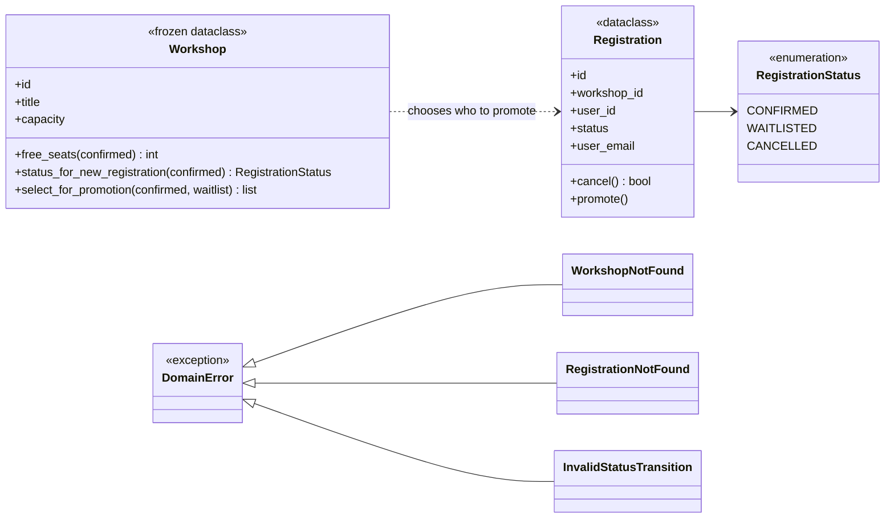

A registration moves through these states:

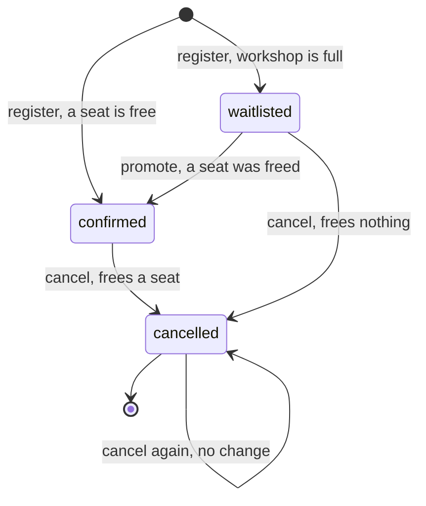

- `Registration.cancel()` returns `True` only when a **confirmed** seat was freed. That value decides whether a promotion is queued.
- `Registration.promote()` raises `InvalidStatusTransition` unless the status is `waitlisted`.
- Registering again after a cancel creates a new row. The database allows it, because the uniqueness rule covers only active rows ([section 10](#10-data-model)).

## 6. Ports and adapters

The application layer depends on the abstract classes in `interfaces.py`. The infrastructure layer implements them. Tests implement them with fakes.

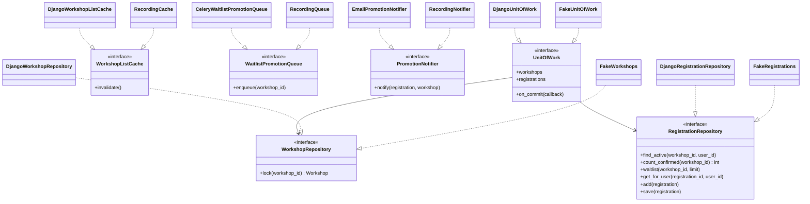

| Port | Production adapter | Test double |
|------|--------------------|-------------|
| `UnitOfWork` | `DjangoUnitOfWork`: `transaction.atomic` and `transaction.on_commit` | `FakeUnitOfWork`: in memory. A commit runs the callbacks. An error restores the data and drops them |
| `WorkshopRepository.lock` | `select_for_update()` on the workshop row | Records which workshops are locked |
| `RegistrationRepository` | Django ORM queries | In-memory list. **Fails any read of seat counts made without the lock** |
| `WorkshopListCache` | Bumps a version key in Redis | Records calls |
| `WaitlistPromotionQueue` | `promote_waitlist.delay(...)` | Records calls |
| `PromotionNotifier` | `send_mail` | Records calls and whether a transaction was still open |

### The composition root

`infrastructure/container.py` is the only place that names concrete classes. Each factory returns a **fresh** use case with its own unit of work, so nothing is shared between requests.

```python
def register_for_workshop() -> RegisterForWorkshop:
    return RegisterForWorkshop(DjangoUnitOfWork(), DjangoWorkshopListCache())
```

Views and the Celery task both call these factories. Do not keep a use case in a module-level variable. A unit of work is single use.

## 7. Flow: register for a workshop

`POST /api/workshops/{id}/register/`

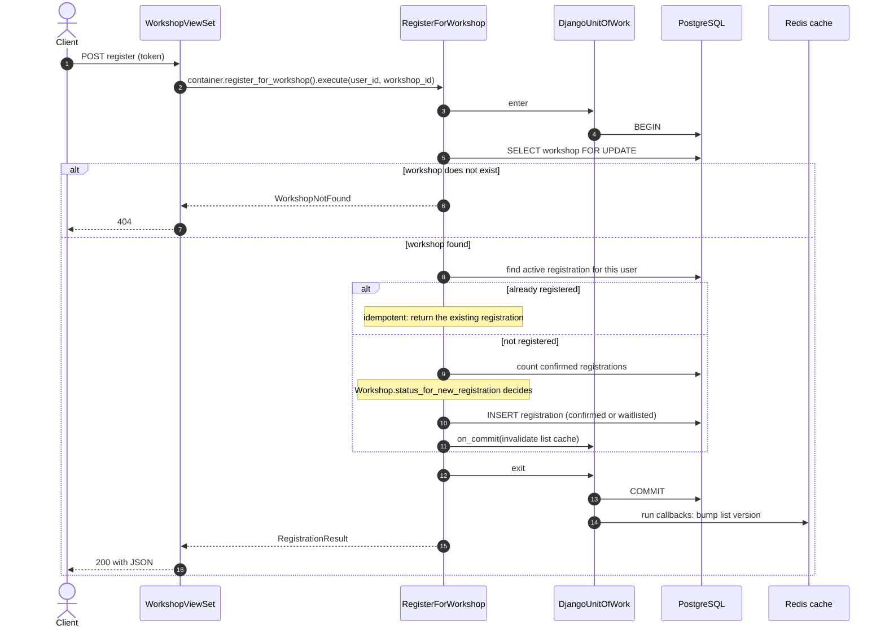

Points to notice:

- The lock is taken **before** any seat count is read. The fake repository checks this order.
- A repeated request returns the existing registration and changes nothing. A client can retry safely.
- The cache is invalidated **after** the commit, through the unit of work. A rolled-back request never touches the cache.

## 8. Flow: cancel and promote the waitlist

`POST /api/registrations/{id}/cancel/` frees a seat. A Celery task then offers it to the oldest waiting person.

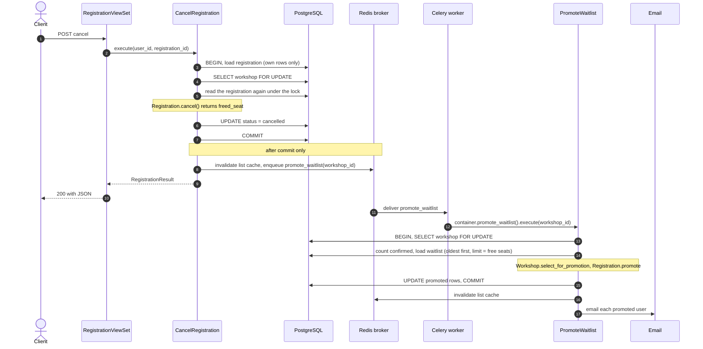

Points to notice:

- The queue message is sent only for a committed change ([ADR 0002](adr/0002-enqueue-celery-tasks-on-commit.md)). A rollback sends nothing.
- No promotion is queued when a **waitlisted** registration is cancelled, because no seat was freed.
- Email is sent **after** the transaction closes. Mail is never sent for a change that is not saved.
- Promotion is idempotent. Running it twice fills free seats once. It is safe to re-run after an outage ([queue backlog runbook](runbooks/queue-backlog.md)).

## 9. Concurrency: the last seat

Two people request the last seat together. The row lock makes one wait.

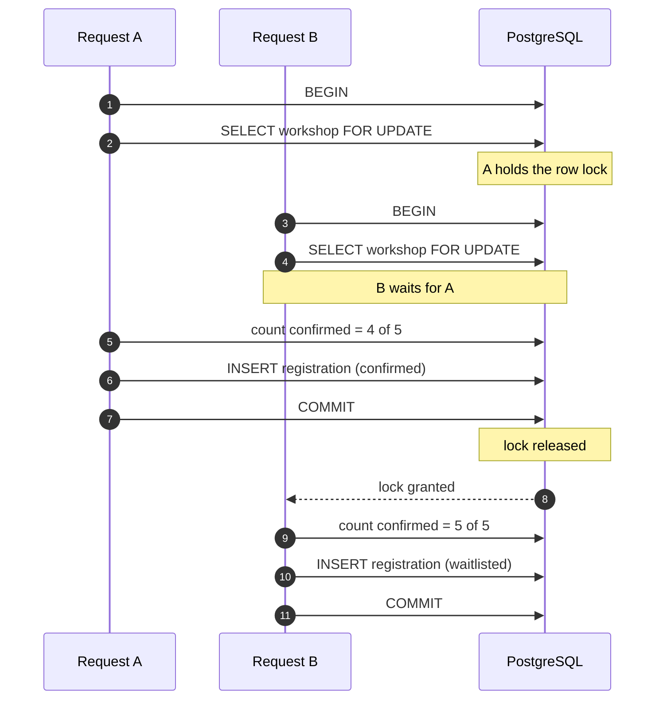

Without the lock, both requests would count 4, both would insert `confirmed`, and the workshop would have 6 of 5 seats.

How this is proven:

- `tests/integration/test_seat_allocation.py::test_concurrent_registrations_never_oversell` fires 20 threads at a 5-seat workshop. It expects exactly 5 confirmed and 15 waitlisted. It runs against real PostgreSQL.
- That test is the **only** proof that the real database lock exists. The fakes cannot prove it. Keep it, and do not delete it to save time.
- A [load test](load-test.md) repeats the race over real HTTP: 200 simultaneous requests for 10 seats against gunicorn. It also shows what happens without the lock.
- The runbook for a failure is [seats-oversold](runbooks/seats-oversold.md). A pooler in statement mode breaks row locks.

## 10. Data model

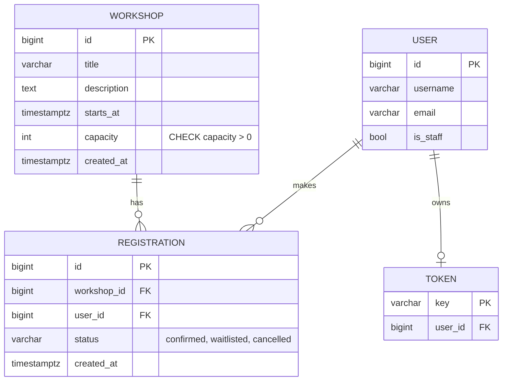

Two constraints back up the code, so they hold even if the application is bypassed:

| Constraint | Rule |
|------------|------|
| `workshop_capacity_positive` | `capacity > 0` |
| `one_active_registration_per_user` | A user has at most one `confirmed` or `waitlisted` registration per workshop. A unique index with a condition on `status`. |

Registrations are ordered by `created_at, id`. That order is what "oldest waitlisted first" means.

## 11. The read side and the cache

Reads hold no business rule, so they do not go through a use case. Views call `infrastructure/db/queries.py` and the Django cache directly.

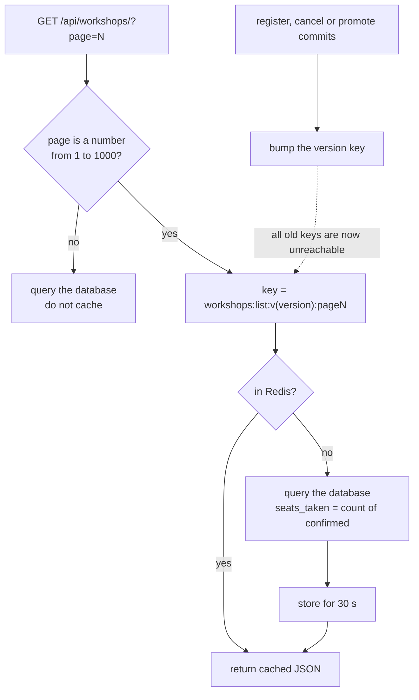

- Only the page number may vary the cache key. A client cannot fill Redis with random keys.
- A version number invalidates every page at once, without knowing which keys exist.
- Invalidation runs after commit, from the unit of work, so it follows the same rule as every other side effect.
- The time to live is `WORKSHOP_LIST_CACHE_SECONDS` (default 30).

## 12. HTTP: errors, auth and rate limits

Authentication is DRF token auth: `Authorization: Token <key>`. Reads are public. Writes need a token.

| Domain error | HTTP answer |
|--------------|-------------|
| `WorkshopNotFound` | `404` "Workshop not found." |
| `RegistrationNotFound` | `404` "Registration not found." Also when it belongs to another user. |
| `InvalidStatusTransition` | Not mapped. It signals a bug, not a user error. |

The interface layer owns this mapping. The domain knows nothing about HTTP.

| Throttle scope | Limit | Applies to |
|----------------|-------|------------|
| `registration` | 10/min | register, cancel (they take a row lock) |
| `login` | 10/min | login |
| `auth` | 10/min | sign-up |
| `anon` | 60/min | everything else, signed out |
| `user` | 120/min | everything else, signed in |

Counters live in Redis, so all web workers share them. `NUM_PROXIES` tells DRF how many proxies sit in front of the app, so it reads the real client address.

Routes (all under `/api/`):

| Method and path | Who | Goes through |
|-----------------|-----|--------------|
| `GET /health/` | anyone | nothing |
| `POST /auth/signup/`, `POST /auth/login/` | anyone | Django auth directly |
| `POST /auth/logout/`, `GET /auth/me/` | user | Django auth directly |
| `GET /workshops/` | anyone | query and cache |
| `POST /workshops/{id}/register/` | user | `RegisterForWorkshop` |
| `GET /registrations/` | user | query |
| `POST /registrations/{id}/cancel/` | user | `CancelRegistration` |
| `GET /organizer/workshops/`, `GET /organizer/workshops/{id}/registrations/` | staff | query |

## 13. Testing strategy

The structure exists to make the right tests cheap.

| Directory | Tests | Needs | What it proves |
|-----------|------:|-------|----------------|
| `tests/unit/domain` | 13 | nothing | Seat rules and status changes on plain objects. |
| `tests/unit/application` | 13 | nothing | Use cases against in-memory fakes: order, side effects, rollback. |
| `tests/test_architecture.py` | 6 | nothing | The layer rules, and that the checker catches a violation. |
| `tests/integration` | 4 | PostgreSQL | Real repositories and unit of work. The 20-thread concurrency test. |
| `tests/api` | 29 | PostgreSQL (all but the health check) | HTTP contract: status codes, auth, throttling, cache. |
| `tests/config` | 8 | Django settings; 2 also use the database | Production settings and the admin flag. |

The first three groups run without a database, in about 0.1 s together (32 tests). The full suite takes about 17 s, almost all of it in the database tests.

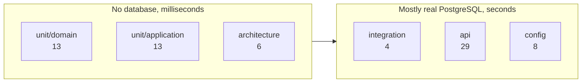

### What the fake repository enforces

The fake turns the rule of ADR 0001 into a test double. It fails any read of seat counts that happens before the lock:

```python
def _require_lock(self, workshop_id: int) -> None:
    assert workshop_id in self.uow.locked, "seat counts read without locking the workshop"
```

Breaking the code confirms it. If `PromoteWaitlist` reads the confirmed count before it locks, 4 unit tests fail in 0.11 s. The same bug passes all 57 tests of the lite variant.

### What no fast test proves

The fakes cannot prove that `DjangoWorkshopRepository.lock` really calls `select_for_update()`. If someone removes it, only the concurrency test fails. This is why that test stays.

### Commands

```bash
docker compose run --rm web pytest                          # everything
docker compose run --rm web pytest tests/unit               # no database
docker compose run --rm web pytest tests/test_architecture.py
docker compose run --rm web ruff check .
docker compose run --rm web ruff format --check .
docker compose run --rm web python manage.py makemigrations --check --dry-run
```

## 14. Where does new code go?

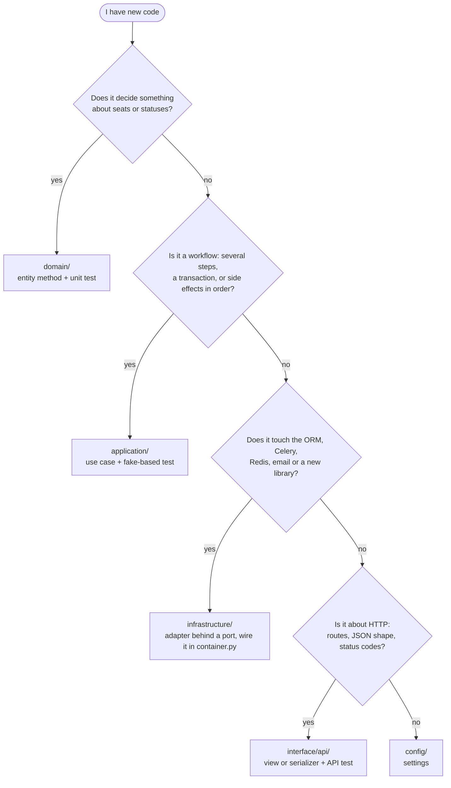

Rules of thumb:

- If a view has an `if` about seats, move it down into `domain/`.
- If a use case imports `django`, add a port and move the call into `infrastructure/`.
- Reads with no rule stay in `queries.py` and the view. Do not wrap them in a use case.

## 15. Recipes

### Add a business rule (for example, a limit on waitlist size)

1. Add a method on `Workshop` or `Registration` in `domain/workshops/entities.py`. Write the unit test first, in `tests/unit/domain`.
2. Call it from the use case in `application/workshops/services.py`. Extend the fakes in `tests/unit/application/fakes.py` if the use case needs new data. Test the order of calls.
3. If the rule needs a new column, add it to the ORM model and write a migration in `infrastructure/db/migrations/`. Map it in `repositories.py`.
4. If the user can see the result, add an API test in `tests/api`.
5. Run `makemigrations --check` and the full suite.

### Add a field to a workshop

Edit four places: the ORM model (and a migration), the repository mapping if the rules read it, the serializer, and the frontend type in `frontend/src/types.ts`. The entity changes only if a rule uses the field.

### Add a side effect (for example, an SMS on promotion)

1. Add a port in `application/workshops/interfaces.py`.
2. Implement it in `infrastructure/`. Wire it in `container.py`.
3. Add a recording fake in `tests/unit/application/fakes.py`.
4. Call it from the use case. Decide when it runs: inside the transaction (rare), through `uow.on_commit`, or after the `with` block as the email does.

### Add another way to call the use cases (a CLI or an import job)

Call `infrastructure.container` factories. Do not copy view code. The use cases already return plain DTOs and raise domain errors, so any caller can map them.

### Add a migration

Create it under `backend/infrastructure/db/migrations/`. The app label is `workshops`, so run:

```bash
docker compose run --rm web python manage.py makemigrations workshops
```

## 16. Known bypasses and gaps

| Item | Detail |
|------|--------|
| **Django admin** | `infrastructure/db/admin.py` lets staff edit registrations directly. This bypasses the use cases and the lock. Treat admin edits of seats as a data fix, reviewed by a second person ([runbook](runbooks/seats-oversold.md)). |
| **Status enum duplicated** | The domain `RegistrationStatus` and the ORM `Registration.Status` are two lists with no test that compares them. A status added only to the model raises `ValueError` at runtime. |
| **`seats_left` computed twice** | `WorkshopSerializer.get_seats_left` repeats `Workshop.free_seats`. |
| **Email can be lost** | It is sent after commit. A worker crash in between loses the email. The seat stays confirmed. |
| **Task can be lost** | A crash between commit and enqueue loses the promotion ([ADR 0002](adr/0002-enqueue-celery-tasks-on-commit.md)). Re-run the recovery in the [queue backlog runbook](runbooks/queue-backlog.md). |
| **Architecture test sees imports only** | It cannot detect a business rule written in a view. Code review and `CODEOWNERS` cover that. |

The full list with follow-ups is in [ADR 0005](adr/0005-clean-architecture-experiment.md#known-gaps-and-follow-ups).

## 17. Glossary

| Term | Meaning here |
|------|--------------|
| Use case | One workflow, such as `RegisterForWorkshop`. Loads, applies a domain rule, saves, triggers side effects. |
| Port | An abstract class in `application/workshops/interfaces.py` that says what a use case needs. |
| Adapter | A concrete class in `infrastructure/` that implements a port. |
| Unit of work | One transaction. A context manager that commits on success and rolls back on error, and can run callbacks after commit. |
| Composition root | The one module (`container.py`) that picks concrete classes. |
| Fake | A test double that implements a port in memory. |
| Active registration | A registration that is `confirmed` or `waitlisted`. |
| Row lock | `SELECT ... FOR UPDATE` on the workshop row. Other requests for the same workshop wait. |
