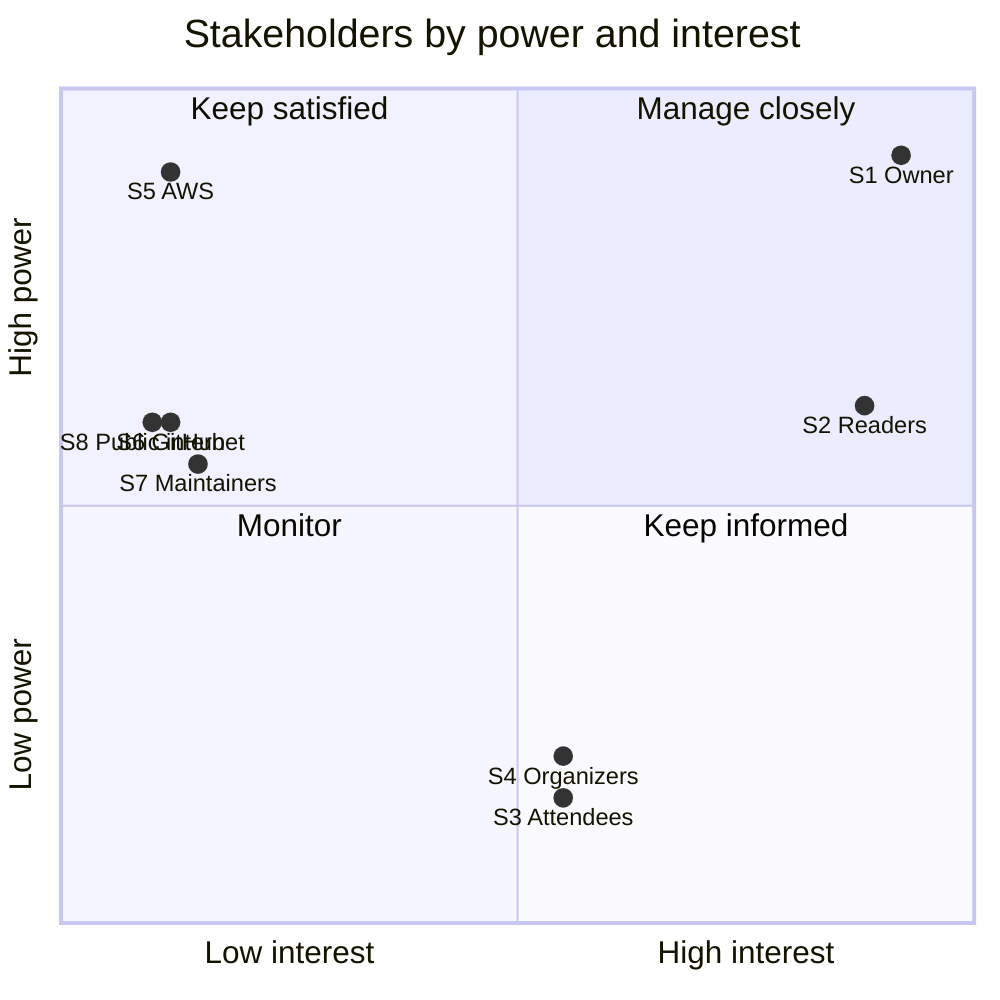

# Stakeholder Register and Engagement Matrix

| | |
|---|---|
| Version | 1.0, issued 2026-10-23 |
| Owner | Massimo Selvi |
| Review | Every month, and when a stakeholder changes |

Seatlock is a public repository with one contributor. Stakeholders are therefore **roles and groups**, not named people. No personal or client information is recorded here.

## 1. Register

Power and interest are scored 1 (low) to 3 (high).

| ID | Stakeholder | Interest in the project | What they expect | Power | Interest |
|----|-------------|-------------------------|------------------|:-----:|:--------:|
| S1 | **Project owner** (sponsor, project manager, tech lead) | Owns scope, schedule, cost and quality. | A project that shows sound engineering and is finished on the baseline. | 3 | 3 |
| S2 | **Repository readers**: hiring managers, engineering peers, people studying the design | Judge the quality of the work from the repository alone. | Claims that can be checked. Clear structure. Honest limits. | 2 | 3 |
| S3 | **Workshop attendees** (a persona, in a demo) | Book a seat, join a waitlist, cancel. | It works, it is quick, a seat is never taken twice. | 1 | 2 |
| S4 | **Workshop organizers** (a persona, in a demo) | See seats taken and who registered. | An accurate dashboard. A way to create workshops (not built yet). | 1 | 2 |
| S5 | **Amazon Web Services** (provider) | Provides the cloud. Sets quotas, policies and prices. | Use within the terms and the account's guardrails. | 3 | 1 |
| S6 | **GitHub** (platform) | Hosts the code, issues, Actions and the Project board. | Use within the free limits. | 2 | 1 |
| S7 | **Open-source maintainers and tool vendors** (Django, DRF, Celery, Vue, UnoCSS, Structurizr and others) | Their releases decide what the project can use. | Pinned versions, upgrades as their own changes. | 2 | 1 |
| S8 | **The public internet**, including attackers (only if a demo is public) | None, but it can cause harm. | Nothing. Treated as a risk source, not a partner. | 2 | 1 |

### Evidence that stakeholders affect the project

- **S7.** The `structurizr/lite` image became a stub that exits, in the middle of this project. The plan changed to the `local` command of `structurizr/structurizr`. The change is in the [change log](05-change-request-log.md) as CR-008.
- **S5.** The AWS dry run waits on the sandbox account's login and policies. This is why issue #43 is `blocked`.
- **S2.** The charter's objective O1 (a proved guarantee) is aimed at readers: the load test and its control run exist so a reader can see the claim fail when the lock is removed.

## 2. Power and interest

| Quadrant | Stakeholders | Approach |
|----------|--------------|----------|
| Manage closely | S1, S2 | Weekly status report. The README, ADRs and diagrams are written for S2. |
| Keep satisfied | S5, S6, S7, S8 | Stay within limits. Pin versions. Harden before exposure. |
| Keep informed | S3, S4 | Personas shape the [PRD](../product/01-prd.md) and the [UX brief](../product/04-ux-design-brief.md). |
| Monitor | none | |

## 3. Engagement assessment

`C` is the current level and `D` the desired level.

| Stakeholder | Unaware | Resistant | Neutral | Supportive | Leading |
|-------------|:-------:|:---------:|:-------:|:----------:|:-------:|
| S1 Owner | | | | | C, D |
| S2 Readers | | | C | D | |
| S3 Attendees | C | | | D | |
| S4 Organizers | C | | | D | |
| S5 AWS | | | C, D | | |
| S6 GitHub | | | C, D | | |
| S7 Maintainers | | | C, D | | |
| S8 Public internet | | | C, D | | |

The gap that matters is S2: readers are neutral now (the repository is public but has no external audience yet), and the aim is for them to find the evidence convincing. The gap for S3 and S4 closes only if a demo is run.

## 4. Engagement plan

| Stakeholder | Strategy | Action | When |
|-------------|----------|--------|------|
| S1 | Decide with facts | Weekly report. Approve the baseline and changes. | Every Friday |
| S2 | Make claims checkable | Keep the load test, the control run and the ADRs current. Add screenshots and the AWS result (item E2). | Phase E |
| S3, S4 | Design for the persona | Keep the stories and the UX brief current. Decide on workshop creation (PRD open question Q1). | Before a demo |
| S5 | Stay inside the rules | Run the preflight script before any deploy. Keep the budget alarm. | Phase A |
| S6 | Stay inside the limits | Pin actions to commit SHAs (#62). Watch the Actions minutes. | Phase A |
| S7 | Absorb change | Pin versions. Review updates through Dependabot (#62). Record tool changes as change requests. | Monthly |
| S8 | Reduce exposure | No public link before phase C. WAF, headers, logs, ALB lock (#47, #58, #59, #63). | Phase C |

## 5. Communication plan

| What | For | Channel | Frequency | Owner |
|------|-----|---------|-----------|-------|
| Weekly status report | S1 | [reports/](reports/) | Weekly | Project manager |
| Release notes | S2, S7 | `CHANGELOG.md` | Per milestone | Project manager |
| Pull request description | S1, S2 | GitHub | Per change | Author |
| Decisions | S1, S2 | ADRs | When a decision is hard to reverse | Tech lead |
| Change requests | S1 | [Change log](05-change-request-log.md) | Per change | Project manager |
| Questions and defects | S2, S3, S4 | GitHub issues | As raised | Project manager |
| Cost alerts | S1 | Email from the budget alarm | When a threshold is crossed | Project manager |

## 6. Review

Review the register every month. Add a stakeholder when a new party can affect the work, for example a person who contributes, or a user once a demo runs.
