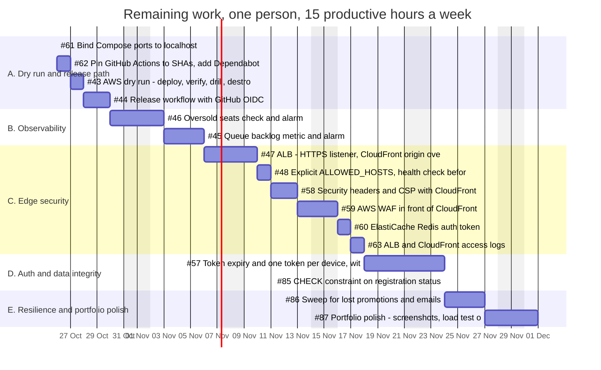

# Estimates and Schedule Baseline

| | |
|---|---|
| Version | 1.0, issued 2026-10-23 |
| State | **Approved baseline**, 2026-10-23 |
| Scope | Milestone v0.6 Hardening and three added items. Everything before 2026-10-23 is reported as actuals. The source code is delivered on 2026-10-23 ([CR-011](05-change-request-log.md#cr-011)); the work below is the release **after** delivery. |
| Capacity | 15 productive hours a week (assumption A1 in the [charter](01-project-charter.md#7-assumptions-constraints-dependencies)) |

## 1. Completed work: plan and actual

The first four milestones had due dates, so their schedule variance can be measured. No effort estimates were written down for them, so cost variance (CPI) cannot be computed. This is a limit of the early planning, and the method below fixes it for the remaining work.

| Milestone | Due | Last item closed (UTC) | Variance | Issues | PRs |
|-----------|-----|------------------------|---------:|-------:|----:|
| v0.1 Foundation | 2026-10-20 | 2026-10-20 20:50 | 0 days | 7 | 12 |
| v0.2 Registration | 2026-10-21 | 2026-10-21 07:14 | 0 days | 4 | 3 |
| v0.3 Operations | 2026-10-22 | 2026-10-21 07:59 | 1 day early | 3 | 4 |
| v0.4 Deploy | 2026-10-23 | 2026-10-21 13:16 | 2 days early | 4 | 4 |
| v0.5 Security | none | 2026-10-21 14:06 | not planned | 8 | 6 |
| v0.6 Hardening | none | open | see below | 14 (1 closed) | 1 |

- **Delivered against the first plan:** all 18 issues of v0.1 to v0.4 (100%). The four milestones were planned across 4 days (20 to 23 October) and were finished in 2 days (20 to 21 October).
- **Added after the plan:** milestone v0.5 (8 issues) and the cost analysis (#64) on 2026-10-21, and then, on 2026-10-22, the architecture change, the frontend restyle, the load test, the CI additions, the C4 model and the preflight script. These are the changes in the [change log](05-change-request-log.md).
- **Throughput for reference:** 154 commits and 42 merged pull requests in 4 active days (26, 97, 28 and 3 commits a day). Early work was scaffolding and is **not** a safe guide for hardening work, so the estimates below do not scale from it.

**Lessons used here.** Plan effort as well as dates. Record the original estimate in the issue. Keep the added work visible, as change requests, so the baseline stays honest.

## 2. Basis of estimate

| Topic | Rule |
|-------|------|
| Unit | Productive hours of focused work. Waiting time (for AWS to create a resource, for CI) is not counted. |
| Method | Three-point estimate for each work package. Expected value E = (O + 4M + P) / 6. Standard deviation SD = (P - O) / 6. |
| O, M, P | Optimistic, most likely and pessimistic hours, set from the issue's checklist and from the closest finished work. |
| Total | Sum of the E values. The SD of the total is the square root of the sum of the variances. It assumes independent errors, so it understates the risk. |
| Reserve | A schedule contingency of 20% of E, added after the packages. It covers the unknowns the estimates leave out. |
| Included | Code, tests, documentation updates, the pull request, the review of the result. |
| Excluded | Time lost to illness or holidays (only 8 December is removed), and work not listed here. |
| Estimator | The project manager. The estimates are proposals until approved. |

## 3. Remaining work: estimates

Packages follow the [implementation plan](../product/06-implementation-plan.md). "new" means no issue exists yet.

| ID | Work package | Issue | Stream | O | M | P | E (h) | SD (h) | Start | Finish |
|---|---|---|---|---:|---:|---:|---:|---:|---|---|
| A1 | Bind Compose ports to localhost | #61 | Technology | 0.5 | 1 | 2 | 1.1 | 0.2 | 2026-10-26 | 2026-10-26 |
| A2 | Pin GitHub Actions to SHAs, add Dependabot | #62 | Technology | 1 | 2 | 3 | 2.0 | 0.3 | 2026-10-26 | 2026-10-27 |
| A3 | AWS dry run: deploy, verify, drill, destroy, fix the guide | #43 | Technology | 3 | 5 | 10 | 5.5 | 1.2 | 2026-10-27 | 2026-10-28 |
| A4 | Release workflow with GitHub OIDC | #44 | Technology | 3 | 5 | 10 | 5.5 | 1.2 | 2026-10-28 | 2026-10-30 |
| B1 | Oversold seats check and alarm | #46 | Technology | 4 | 6 | 10 | 6.3 | 1.0 | 2026-10-30 | 2026-11-03 |
| B2 | Queue backlog metric and alarm | #45 | Technology | 4 | 6 | 12 | 6.7 | 1.3 | 2026-11-03 | 2026-11-06 |
| C1 | ALB: HTTPS listener, CloudFront origin over HTTPS, secret header | #47 | Technology | 4 | 8 | 16 | 8.7 | 2.0 | 2026-11-06 | 2026-11-10 |
| C2 | Explicit ALLOWED_HOSTS, health check before host validation | #48 | Technology | 1 | 2 | 4 | 2.2 | 0.5 | 2026-11-10 | 2026-11-11 |
| C3 | Security headers and CSP with CloudFront | #58 | Technology | 3 | 4 | 8 | 4.5 | 0.8 | 2026-11-11 | 2026-11-13 |
| C4 | AWS WAF in front of CloudFront | #59 | Technology | 2 | 3 | 6 | 3.3 | 0.7 | 2026-11-13 | 2026-11-16 |
| C5 | ElastiCache Redis auth token | #60 | Technology | 2 | 3 | 6 | 3.3 | 0.7 | 2026-11-16 | 2026-11-17 |
| C6 | ALB and CloudFront access logs | #63 | Technology | 2 | 3 | 5 | 3.2 | 0.5 | 2026-11-17 | 2026-11-18 |
| D1 | Token expiry and one token per device, with an ADR | #57 | Technology | 6 | 10 | 20 | 11.0 | 2.3 | 2026-11-18 | 2026-11-24 |
| D2 | CHECK constraint on registration status | #85 | Technology | 1 | 2 | 3 | 2.0 | 0.3 | 2026-11-24 | 2026-11-24 |
| E1 | Sweep for lost promotions and emails | #86 | Technology | 4 | 8 | 16 | 8.7 | 2.0 | 2026-11-24 | 2026-11-27 |
| E2 | Polish: screenshots, load test on AWS, demo notes | #87 | Product | 2 | 4 | 8 | 4.3 | 1.0 | 2026-11-27 | 2026-12-01 |
| | **Total** | | | | | | **78.2** | **4.7** | 2026-10-26 | 2026-12-01 |

Totals: **78.2 h** expected. P80 (E + 0.84 SD) is 82.2 h. The 20% reserve adds 15.7 h, for **93.9 h** with reserve.

The three added items (D2, E1, E2) are not in milestone v0.6 yet. Creating their issues is part of approving this baseline. D2 comes from a finding in the [backend schema](../product/05-backend-schema.md#5-findings): the database does not constrain the `status` column. E1 closes ADR 0005 gaps 3 and 4.

## 4. Schedule

One person works the packages in sequence, so the schedule is driven by capacity, not by dependencies. The order puts the risky and the blocking work first.

| Phase | Name | Hours (E) | Start | Finish |
|---|---|---:|---|---|
| A | Dry run and release path | 14.1 | 2026-10-26 | 2026-10-30 |
| B | Observability | 13.0 | 2026-10-30 | 2026-11-06 |
| C | Edge security | 25.2 | 2026-11-06 | 2026-11-18 |
| D | Auth and data integrity | 13.0 | 2026-11-18 | 2026-11-24 |
| E | Resilience and polish | 13.0 | 2026-11-24 | 2026-12-01 |

### Milestones

| ID | Milestone | Finish | Meaning |
|----|-----------|--------|---------|
| M1 | Dry run and release path | 2026-10-30 | The deploy guide has been run on a real account. A release workflow exists. |
| M2 | Observability | 2026-11-06 | The two missing alarms exist: oversold seats and queue backlog. |
| M3 | Edge security | 2026-11-18 | The ALB, CloudFront, headers, WAF, Redis auth and logs are hardened. No public demo before this. |
| M4 | Auth and data integrity | 2026-11-24 | Tokens expire and are per device. The database constrains the status. |
| M5 | Resilience and polish | 2026-12-01 | Lost promotions are swept. The AWS result is shown in the README. |
| D | **v1.0 Source delivery** | **2026-10-23** | Done. The code, tests and documents on `main`. Open gaps are the v0.6 issues. |
| R | **v0.6 released (baseline)** | **2026-12-09** | M5 plus the 20% reserve. This is the committed date. |

The target is 2026-12-01. The committed baseline date is **2026-12-09**. The difference is the reserve.

### Dependencies

| Package | Depends on | Type |
|---------|------------|------|
| A3 AWS dry run | The sandbox login and the budget alarm (owner action) | External. Today's block. |
| A4 release workflow | A3, for the real role and the real image push | Logical |
| B1, B2 alarms | A3, to check the metrics on a real stack | Logical |
| C1 to C6 | A3, to check the changes on a real stack | Logical |
| C1 HTTPS to the ALB | A domain name for the certificate | External. Decision needed. |
| D1 token expiry | An ADR on cookies versus a header | Logical |
| E2 AWS result in the README | A3 | Logical |

**Critical path.** The only chain that cannot move is A3 then everything that is checked on AWS (A4, B1 to C6, E2). If A3 is late, those packages are late. D1, D2 and E1 do not need AWS, so they are the buffer to work on while A3 waits.

### Sensitivity to capacity

| Capacity | Finish, expected | Finish, with reserve |
|---------:|------------------|----------------------|
| 10 h a week | 2026-12-21 | 2026-12-30 |
| **15 h a week (baseline)** | **2026-12-01** | **2026-12-09** |
| 20 h a week | 2026-11-20 | 2026-11-26 |

## 5. Cost baseline

| Item | Baseline | Cap |
|------|---------:|----:|
| AWS dry run (about 4 hours of the demo stack, plus the load test) | 3 USD | 10 USD |
| Domain name for C1 | not yet quoted | decision needed |
| Everything else | 0 | |

Source: [cost analysis](../cost-analysis.md) and the [deploy guide](../deploy.md). Spend is read from Cost Explorer a day after teardown, because cost data lags.

## 6. Baseline control

**Planned value.** Cumulative planned hours at the end of each week, using E without the reserve.

| Week ending | 30 Oct | 6 Nov | 13 Nov | 20 Nov | 27 Nov | 4 Dec |
|-------------|-------:|------:|-------:|-------:|-------:|------:|
| Planned hours | 15.0 | 30.0 | 45.0 | 60.0 | 75.0 | 78.2 |

A package earns its hours when its issue is closed and its pull request is merged. Schedule performance index SPI = earned hours / planned hours. Cost performance index CPI = earned hours / hours actually spent. The owner records the hours spent in each weekly report.

**Thresholds**

| Signal | Rule |
|--------|------|
| Green | SPI at least 0.9, and no phase more than 1 working day late. |
| Amber | SPI between 0.8 and 0.9, or a phase 2 to 3 days late. Say so in the report and name the recovery. |
| Red | SPI below 0.8, a phase more than 3 days late, or the committed date at risk. Raise a change request to re-baseline. |

**Re-baselining.** The baseline changes only through an approved [change request](05-change-request-log.md). Actuals never overwrite the baseline: the baseline version is kept and a new version is added.

## 7. Schedule risks

See the [charter risk table](01-project-charter.md#8-risks). The ones that move dates:

- R1: the dry run finds defects. A3 has the widest range (3 to 10 hours).
- R3: the capacity assumption. See the sensitivity table.
- C1 needs a domain name, which is an external decision.

## 8. Approval

| Role | Name | Decision | Date |
|------|------|----------|------|
| Sponsor and project manager | Massimo Selvi | Approved | 2026-10-23 |
