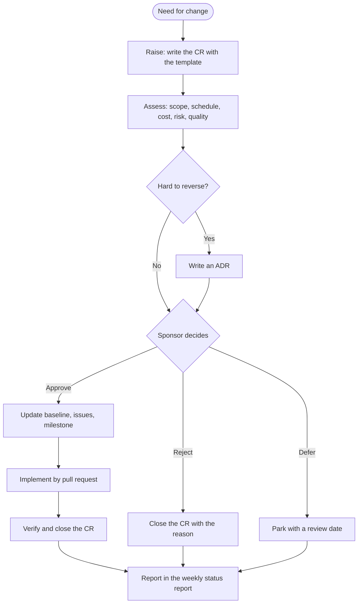

# Change Request Log and Workflow

| | |
|---|---|
| Version | 1.0, issued 2026-10-23 |
| Owner | Project manager |
| Decides | Sponsor (the change control board has one member) |
| Baseline | [Charter](01-project-charter.md) and [schedule baseline](03-estimates-and-schedule-baseline.md) |

A change request (CR) is a recorded decision to change **scope, schedule, cost, quality or architecture** after the baseline. The aim is not to slow work down. The aim is that no change is hidden, and that the cost of each change is known when it is accepted.

## 1. What needs a CR

| Change | CR? | Where it is recorded |
|--------|:---:|----------------------|
| New feature, new document set, new tool | Yes | This log |
| A package takes more than 50% over its estimate | Yes | This log |
| A milestone date moves | Yes | This log, then the baseline |
| Cloud cost changes by more than 1 USD a month | Yes | This log |
| A hard-to-reverse architecture decision | Yes | An ADR, and one line here |
| A bug fix inside an existing package | No | Pull request |
| A refactor with no change of behavior or plan | No | Pull request |

## 2. Workflow

<a id="workflow"></a>



1. **Raise.** Copy the template in section 4. Give the next CR number.
2. **Assess.** Write the effect on hours, dates, cost, risk and quality. If unknown, say so, and give a time-box to find out.
3. **Decide.** The sponsor writes Approved, Rejected or Deferred, with the date.
4. **Apply.** Update the [baseline](03-estimates-and-schedule-baseline.md#6-baseline-control) when schedule or effort moves. Link the pull request.
5. **Close.** Mark Implemented when the pull request is merged and the checks are green.

## 3. Classification

| Field | Values |
|-------|--------|
| Type | Scope, Schedule, Cost, Quality, Architecture, Tooling |
| Priority | Must (security, correctness), Should, Could |
| Size | S (up to 2 h), M (2 to 8 h), L (more than 8 h) |
| Timing | In advance, or **Recorded afterwards** when the decision came first and the record followed |

## 4. Template

```markdown
### CR-NNN: <short title>

| | |
|---|---|
| Raised | <date>, by <role> |
| Type, priority, size | <type>, <priority>, <size> |
| Timing | In advance / Recorded afterwards |
| Decision | Approved / Rejected / Deferred, <date> |
| Status | Open / Implemented / Closed |
| Links | <issues, pull requests, ADRs> |

**Change.** <What changes, in two sentences.>
**Reason.** <Why now. What happens if we do nothing.>
**Impact.** Scope: <> . Schedule: <> . Cost: <> . Risk: <> . Quality: <>.
**Alternatives.** <What else was considered.>
```

## 5. Log

All eleven entries below were decided during the first week (2026-10-20 to 2026-10-23). The change process was written on day 4, so they are **recorded afterwards** from the pull requests and the repository history. Effort is not given: hours were not recorded.

| ID | Date | Title | Type | Priority | Size | Decision | Status | Links |
|----|------|-------|------|----------|:----:|----------|--------|-------|
| [CR-001](#cr-001) | 2026-10-21 | Add a security milestone (v0.5) | Scope | Must | L | Approved | Implemented | #65 to #70 |
| [CR-002](#cr-002) | 2026-10-21 | Add a cost analysis with sourced prices | Scope | Should | M | Approved | Implemented | #71 |
| [CR-003](#cr-003) | 2026-10-22 | Adopt Clean Architecture for the backend | Architecture | Should | L | Approved | Implemented | #75, ADR 0005 |
| [CR-004](#cr-004) | 2026-10-22 | Restyle the frontend with UnoCSS | Scope | Could | L | Approved | Implemented | #74, #75, ADR 0006 |
| [CR-005](#cr-005) | 2026-10-22 | Add a load test over HTTP and a CI job | Quality | Must | M | Approved | Implemented | #78, #79, #80 |
| [CR-006](#cr-006) | 2026-10-22 | Accept ALB traffic only from CloudFront, tag resources | Architecture | Must | M | Approved | Implemented | #81 |
| [CR-007](#cr-007) | 2026-10-22 | Add a read-only AWS preflight script | Scope | Should | M | Approved | Implemented | #82 |
| [CR-008](#cr-008) | 2026-10-23 | Replace Structurizr Lite with `structurizr local` | Tooling | Must | S | Approved | Implemented | #83 |
| [CR-009](#cr-009) | 2026-10-23 | Add a C4 model of the system | Scope | Should | L | Approved | Implemented | #83 |
| [CR-010](#cr-010) | 2026-10-23 | Move the ADRs into the C4 folder | Scope | Could | S | Approved | Implemented | #83 |
| [CR-011](#cr-011) | 2026-10-23 | Deliver the source code on 2026-10-23, move hardening after delivery | Schedule | Must | M | Approved | Implemented | #88 |

### CR-001
**Change.** After a first review, add a milestone v0.5 Security with six pull requests: login rate limit, fail-closed `SECRET_KEY`, production settings, cache key, `/admin` off the internet, non-root container, restricted CI token.
**Reason.** The review found defects that would matter on the first public deploy. Doing nothing leaves them for the dry run.
**Impact.** Scope: six pull requests added. Schedule: none, closed in one day. Cost: none. Risk: lowers R5. Quality: higher.
**Alternatives.** Defer all to hardening. Rejected: some fixes change defaults the deploy depends on.

### CR-002
**Change.** Add `docs/cost-analysis.md` with prices taken from the AWS price list.
**Reason.** Objective O3 has a cost cap of 10 USD. The cap needs a basis.
**Impact.** Scope: one document. Schedule: none. Cost: none. Risk: lowers R2. Quality: neutral.
**Alternatives.** Use the AWS pricing calculator only. Rejected: not reproducible from the repository.

### CR-003
**Change.** Split the backend into domain, application, infrastructure and interface layers, enforced by `tests/test_architecture.py`.
**Reason.** The seat rules were hard to test without a database. The split makes them plain Python and makes the design easy to explain.
**Impact.** Scope: restructure, no new behavior. Schedule: one day. Cost: none. Risk: a regression in seat logic, covered by the concurrency test and later the load test. Quality: higher.
**Alternatives.** The lighter variant `exp/clean-arch-lite`. Rejected in the comparison in ADR 0005.

### CR-004
**Change.** Restyle the frontend with UnoCSS, design tokens and a dark theme.
**Reason.** The first UI was unstyled. A reader judges the project by what it shows.
**Impact.** Scope: new styling system. Schedule: one day. Cost: none. Risk: R4, effort on polish instead of hardening. Quality: higher, with accessibility checks.
**Alternatives.** Tailwind, Open Props, Pico CSS, plain CSS. UnoCSS chosen in ADR 0006.

### CR-005
**Change.** Add `backend/scripts/load_test.py`: 200 simultaneous registrations for 10 seats over real HTTP, with a control run without the lock, and a CI workflow.
**Reason.** The concurrency test uses threads. It does not prove the guarantee through the real server.
**Impact.** Scope: one script, one workflow, one document. Schedule: none. Cost: CI minutes only. Risk: lowers R6. Quality: supports O1.
**Alternatives.** Run it by hand only. Rejected: a claim needs a check that cannot be skipped.

### CR-006
**Change.** The load balancer accepts traffic only from CloudFront. Every resource gets tags, including `DestroyBy`.
**Reason.** An open ALB bypasses the edge. Tags are needed to find and delete resources after a dry run.
**Impact.** Scope: infra change. Schedule: none. Cost: none. Risk: lowers R2 and the exposure of the ALB. Quality: higher.
**Alternatives.** A custom header secret. Left to the hardening milestone as a second layer.

### CR-007
**Change.** Add `infra/scripts/preflight.sh`. It only reads, and checks the account, quotas and the budget before any deploy.
**Reason.** The first deploy into a sandbox account can fail for reasons outside the code. Finding them first saves a failed deploy.
**Impact.** Scope: one script. Schedule: none. Cost: none. Risk: lowers R1. Quality: neutral.
**Alternatives.** Find the problems during the deploy. Rejected: slower and may leave partial resources.

### CR-008
**Change.** Use `structurizr/structurizr local` instead of `structurizr/lite`.
**Reason.** The `lite` image became a stub that exits. This is risk R8 happening.
**Impact.** Scope: one command in the docs and CI. Schedule: about an hour. Cost: none. Risk: none new. Quality: neutral.
**Alternatives.** Pin an old tag of `lite`. Rejected: an unmaintained image.

### CR-009
**Change.** Add a C4 model in Structurizr: 23 views, deployment views for AWS, Docker Compose and CI, with icons.
**Reason.** The architecture was in prose and a few diagrams. A model keeps the views consistent with each other.
**Impact.** Scope: new `docs/architecture/` tree. Schedule: one day. Cost: none. Risk: R4. Quality: higher for readers (S2).
**Alternatives.** Hand-drawn Mermaid only. Kept for `docs/architecture.md`.

### CR-010
**Change.** Move the ADRs into `docs/architecture/adr/` and show them in the Structurizr viewer. Remove the duplicate decisions page.
**Reason.** One source for decisions, visible in the model.
**Impact.** Scope: file moves, 27 links updated. Schedule: under an hour. Cost: none. Risk: broken links, checked by a link checker. Quality: neutral.
**Alternatives.** Keep both copies. Rejected: they drift.

### CR-011
**Change.** Add a delivery milestone v1.0 on 2026-10-23. Deliver the code, tests and documents on `main` as they are. Milestone v0.6 Hardening stays a separate release after delivery, with its baseline of 2026-12-09.
**Reason.** The sponsor must hand over the source code today. The remaining work is 78.2 expected hours, about 94 with the reserve. It cannot be done in one day without dropping the dry run on AWS, which the plan puts first.
**Impact.** Scope: O3 (deployed once) and O4 (hardened) are not met at delivery and are listed as known limits. Schedule: delivery is 2026-10-23. v0.6 dates do not move. Cost: none. Risk: R5 rises if the code is shared as a ready service; the README must say the deploy guide was not run on AWS and which hardening issues are open. Quality: no change.
**Alternatives.** Pull a subset (A1, A2) into today. Rejected: it adds risk on the day of delivery for little gain. Move all dates earlier. Rejected: the estimate does not allow it.

## 6. Observations

- Six of eleven changes are **Scope** and three of those are documents or diagrams. This is risk R4. The [workstream cap](06-workstream-structure.md#capacity-rule) now limits it.
- Only CR-001, CR-005 and CR-006 are **Must**. They address security and correctness, and are the changes that reduce risk.
- No CR was rejected or deferred. This is a sign that the process was not used as a gate yet. From now on a CR is raised **before** the work starts.

## 7. Follow-ups (proposals, not yet applied)

| # | Proposal | Decision |
|---|----------|----------|
| 1 | Create a GitHub label `change-request` and add a "CR number" line to the pull request template. | Approved 2026-10-23. Label created. PR template line still to do. See [decisions needed](reports/2026-W43.md#decisions-needed) |
| 2 | Mirror the log as GitHub issues only if the log grows past about 30 entries. | Not needed now |
