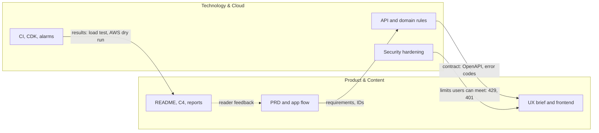

# Workstream Structure

| | |
|---|---|
| Version | 1.0, issued 2026-10-23 |
| Owner | Project manager |
| Review | At each milestone |

The work is split in two workstreams. The split keeps one question visible: **how much effort goes into what the reader sees, and how much into what makes the system true.**

| | Product & Content | Technology & Cloud |
|---|---|---|
| Question it answers | What does the project say and show? | Does the system do what it says, safely? |
| Lead | Massimo Selvi | Massimo Selvi |
| Share of remaining effort | 4.3 h of 78.2 h (5.5%) | 73.9 h (94.5%) |
| Cap | At most 25% of weekly hours | The rest |

One person leads both. The split is about **accountability for outcomes and for effort**, not about people.

## 1. Product & Content

**Scope.** Everything a reader, attendee or organizer meets, and the words that explain it.

| Area | Deliverables |
|------|--------------|
| Product definition | [PRD](../product/01-prd.md), [App flow](../product/03-app-flow.md), [UX brief](../product/04-ux-design-brief.md) |
| Frontend experience | Vue pages, UnoCSS tokens, dark theme, accessibility |
| Documentation for readers | README, screenshots, the C4 model and its views, ADR readability |
| Project communication | [Weekly report](04-weekly-status-report.md), release notes |

**Done when.** A new reader can understand what Seatlock promises, see it, and find the proof within five minutes, without asking.

## 2. Technology & Cloud

**Scope.** Everything that makes the promise true and keeps it true.

| Area | Deliverables |
|------|--------------|
| Seat allocation | Domain rules, use cases, row lock, DB constraints |
| Backend platform | API, Celery worker, cache, migrations, [schema](../product/05-backend-schema.md), [technical requirements](../product/02-technical-requirements.md) |
| Quality gates | Unit, integration and load tests, CI, architecture test |
| Cloud and operations | CDK stacks, deploy guide, SLOs, alarms, runbooks, preflight |
| Security | Rate limits, settings, headers, WAF, tokens, logs |

**Done when.** The checks pass on `main`, the deploy guide has been run on a real account, and every alarm in the SLO document exists.

## 3. Interfaces between the streams

| From | To | What crosses | Rule |
|------|----|--------------|------|
| Product | Technology | Requirement IDs (FR, NFR) | A requirement without an ID is not planned. |
| Technology | Product | API contract and error codes | A change of contract is a [change request](05-change-request-log.md). |
| Technology | Product | Measured results (load test, AWS dry run) | Numbers in documents come from a command, not memory. |
| Technology | Product | New limits (rate limit, token expiry) | The UI shows a clear message for each. |

## 4. Responsibility matrix

R: does the work. A: accountable. C: consulted. I: informed. One person holds every role today, so the table also names the **control** that stands in for a second pair of eyes.

| Activity | Product & Content | Technology & Cloud | Control |
|----------|:----:|:----:|---------|
| Define a feature (PRD) | A, R | C | Acceptance criteria with a named test |
| Change the API contract | C | A, R | Test and OpenAPI diff in the pull request |
| Seat allocation rules | I | A, R | Concurrency test, load test |
| Choose the UI style | A, R | C | ADR 0006 |
| Deploy to AWS | I | A, R | Preflight, budget alarm, destroy gate |
| Approve scope change | A | A | Sponsor decision in the change log |
| Publish a claim in the README | A, R | C | The claim links to a test or a measured result |

## 5. Work mapping

Open issues of milestone v0.6, by workstream. "new" means no issue exists yet.

| Workstream | Packages | Issues |
|------------|----------|--------|
| Technology & Cloud | A1 to A4 | #61, #62, #43, #44 |
| Technology & Cloud | B1, B2 | #46, #45 |
| Technology & Cloud | C1 to C6 | #47, #48, #58, #59, #60, #63 |
| Technology & Cloud | D1, D2 | #57, #85 |
| Technology & Cloud | E1 | #86 |
| Product & Content | E2 | #87 |

## 6. Capacity rule

Risk R4 in the [charter](01-project-charter.md#8-risks): documents and tooling can grow faster than the product. In the first week the repository gained 42 merged pull requests, and many were documents (see CR-002, CR-009, CR-010).

- Product & Content takes **at most 25% of the hours in any week**.
- Above 25% for a week, the project manager writes it in the [status report](04-weekly-status-report.md) under Risks.
- Above 25% for two weeks in a row, new Product & Content work needs a [change request](05-change-request-log.md) first.
- The project and product documents of this set are the planned exception. After they merge, the rule applies from the week of 2026-10-26.

The rule needs hours. They are **not recorded yet**. The first step is to record hours per stream in the weekly report.

## 7. Key measures per stream

| Stream | Measure | Source | Target |
|--------|---------|--------|--------|
| Technology | Confirmed seats after 200 requests for 10 seats | `backend/scripts/load_test.py` | Exactly 10 |
| Technology | Backend coverage | `pytest --cov` | At least 95% |
| Technology | Open v0.6 issues | `gh issue list` | 0 at release |
| Technology | Cloud spend | Budget alarm | At most 10 USD |
| Product | Requirements with a test | Traceability table in the [PRD](../product/01-prd.md) | 100% of Must |
| Product | Broken links in `docs/` | Link check in the pull request | 0 |
| Product | Hours share | Weekly report | At most 25% |

## 8. Definition of done

A package is done when all lines hold. Lines marked T apply to Technology & Cloud, and P to Product & Content.

- All: the pull request is merged, the checks are green, and the issue is closed with the pull request linked.
- T: a test exists that fails if the behavior breaks.
- T: if the architecture changed, an ADR is merged. If infra changed, `cdk diff` is in the pull request.
- P: every claim links to a test, a measurement or a file.
- P: links resolve and diagrams render.
- All: the [status report](04-weekly-status-report.md) lists it.
