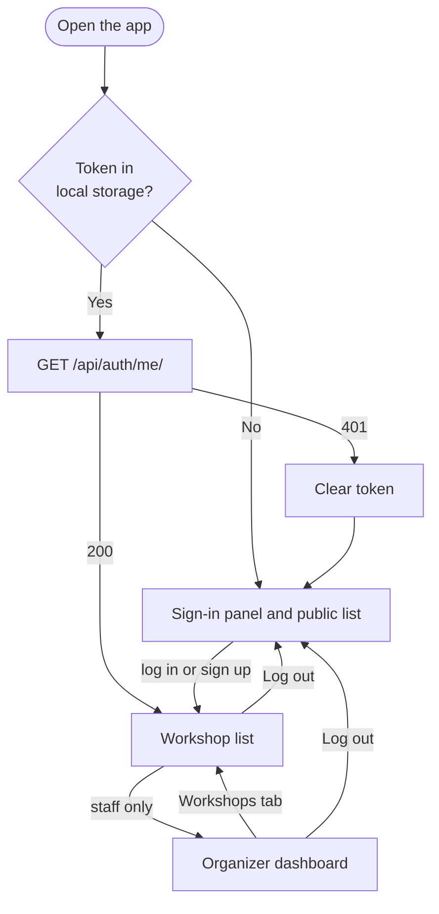
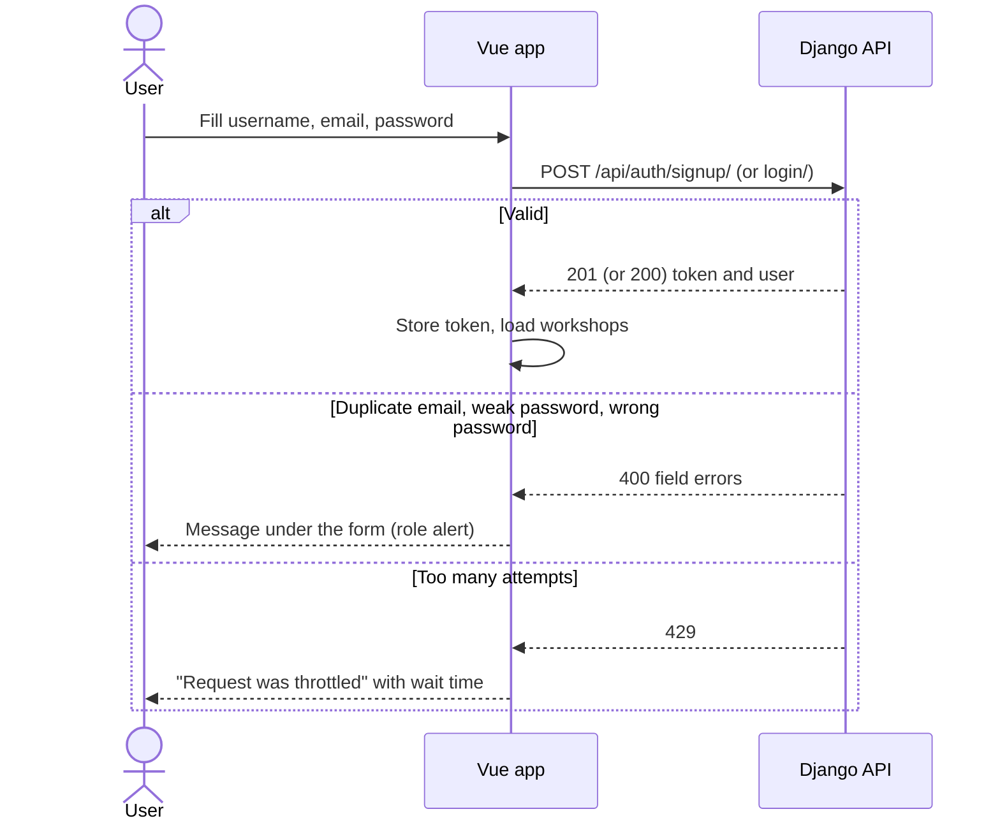
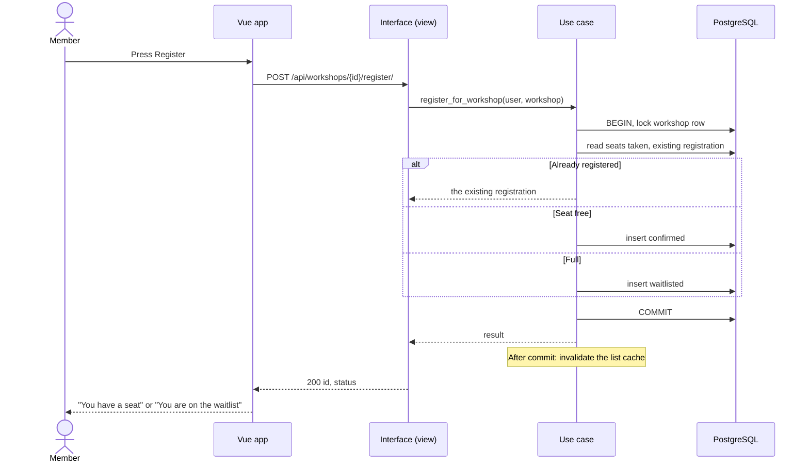
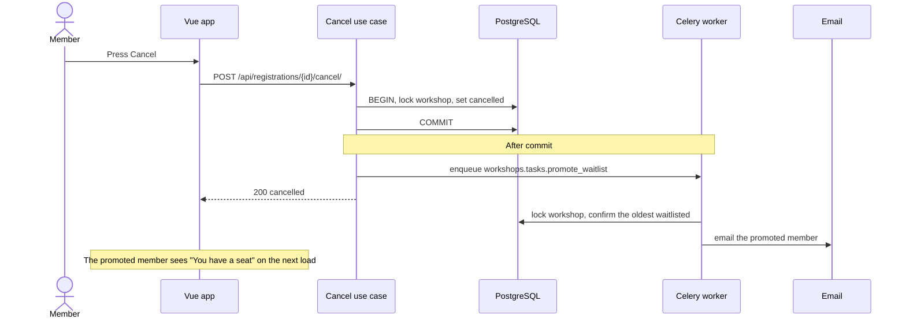
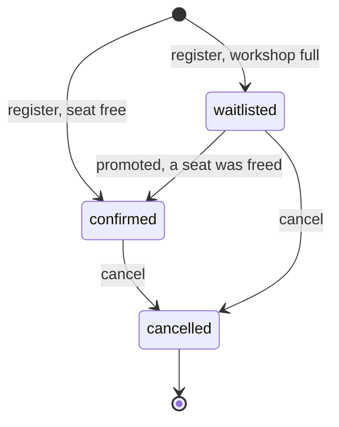
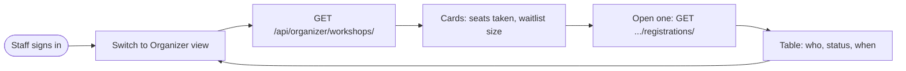

# App Flow

| | |
|---|---|
| Version | 1.0, issued 2026-10-23 |
| Owner | Massimo Selvi |
| Related | [PRD](01-prd.md), [UX brief](04-ux-design-brief.md), [Architecture guide](../architecture.md) |

The app is a single page. There are no routes: the page shows the workshop list, and staff can switch to the organizer dashboard. The sign-in panel replaces the list for visitors who are not signed in.

## 1. Screen map

| Screen | Who sees it | Content |
|--------|-------------|---------|
| Sign-in panel | Visitor | Log in or create an account. Switch link between the two. |
| Workshop list | Member, staff | Cards with title, time, seats left, status of my registration, Register, Join waitlist or Cancel. |
| Organizer dashboard | Staff | Per workshop: seats taken, waitlist size, list of registrations. |

A visitor sees the sign-in panel **above** the workshop list. The list is public in the API, so a visitor can read seats before making an account. Register, Join waitlist and Cancel appear only after sign-in.

## 2. Sign-up and log-in

## 3. Register for a workshop

Two people press Register on the last seat at the same moment: both requests reach step "lock workshop row". The database lets one pass. The second waits, then sees zero seats and is waitlisted. This is the proof the [load test](../load-test.md) checks.

## 4. Cancel and promotion

## 5. Registration states

`confirmed` and `waitlisted` are **active**. A user can have only one active registration per workshop. After `cancelled`, the user can register again, which creates a new row.

## 6. Organizer flow

A non-staff user who calls these endpoints gets 403. The nav item is hidden for them.

## 7. Screen states

| Screen | Loading | Empty | Error | Success |
|--------|---------|-------|-------|---------|
| Workshop list | Three pulsing placeholder cards, `aria-busy` | Inbox icon and "No workshops yet. Check back soon." | Banner with `role="alert"` | Cards |
| Card action | Button disabled while the call runs | n/a | Message under the card | Status text changes, `aria-live` announces it |
| Sign-in panel | Button disabled | n/a | Message under the form | Panel closes |
| Organizer dashboard | Placeholder | "No registrations" | Banner | Numbers and table |

## 8. Error paths

| Case | HTTP | What the user sees | What the user can do |
|------|:----:|--------------------|----------------------|
| Wrong password | 400 | The API message | Retry |
| Duplicate email on sign-up | 400 | The API message | Log in instead |
| Too many attempts | 429 | "Request was throttled. Expected available in N seconds." | Wait |
| Token expired or removed | 401 | Back to the sign-in panel | Log in |
| Workshop deleted meanwhile | 404 | "Workshop not found." | Reload the list |
| Cancel someone else's registration | 404 | "Registration not found." | None. The UI never offers it. |
| Not staff on the organizer API | 403 | Dashboard is not offered | None |
| Network down or server error | 5xx | "Something went wrong" | Retry |

## 9. Cross-cutting rules

- The token is kept in local storage under `seatlock.token`. Logging out deletes it on the server and in the browser.
- A double press is safe: registering twice returns the same registration (FR-06).
- The list is cached for 30 s on the server and is dropped when seats change. A refresh may therefore show a count that is a few seconds old after a change by someone else, never after your own action.
