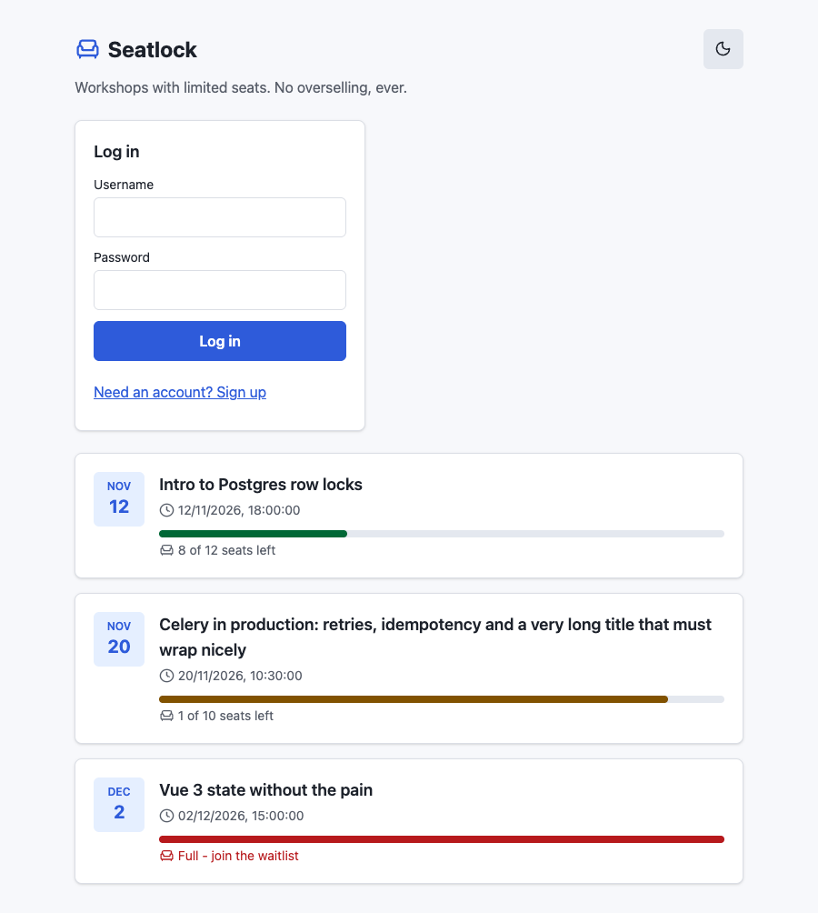
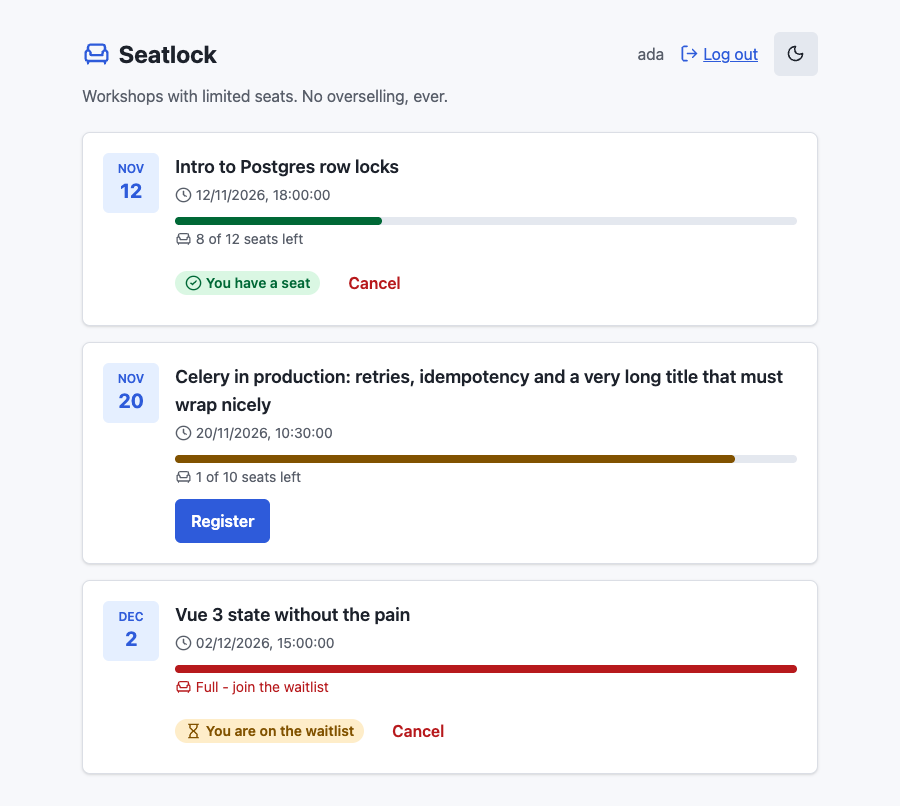
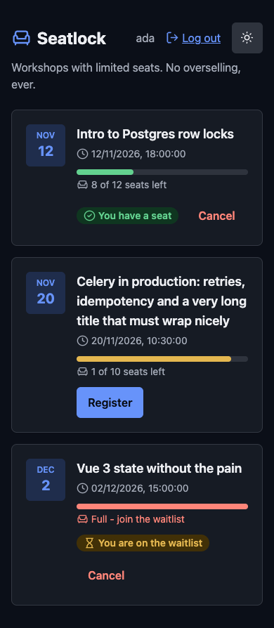
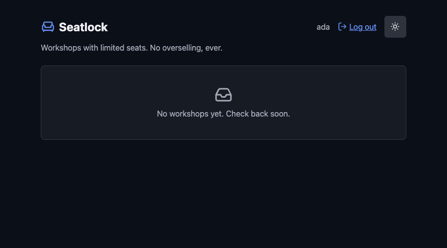
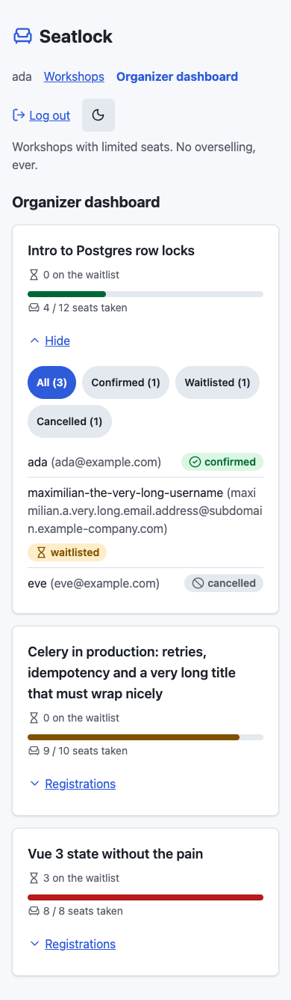

# UI/UX Design Brief

| | |
|---|---|
| Version | 1.0, issued 2026-10-23 |
| Owner | Massimo Selvi |
| Related | [PRD](01-prd.md), [App flow](03-app-flow.md), [ADR 0006](../architecture/adr/0006-style-the-frontend-with-unocss.md), [frontend polish plan](../frontend-polish-plan.md) |

This brief describes the interface as built and the rules for changing it. It is a brief for the next person who touches the UI, including the owner in six months.

## 1. Goal

Make one thing obvious in under a second: **do I have a seat?** Everything else supports that.

## 2. Users and context

| Persona | Device | Context |
|---------|--------|---------|
| Ada, attendee | Phone, often | Quick, one hand, possibly outside. |
| Omar, organizer | Laptop | Checks numbers before an event. |
| Rita, reader | Laptop | Opens the app from the README and looks at it for a minute. |

## 3. Design principles

1. **Status first.** Seats left and my status are the largest information on a card.
2. **Say it in words.** Color is never the only signal. A meter has text beside it. A badge has a label.
3. **Calm and plain.** One accent color, system fonts, little decoration. The product is about trust.
4. **Every state is designed.** Loading, empty, error and success, not only the happy path.
5. **Safe to press twice.** A button disables while its call runs. The server is idempotent too.
6. **Both themes, no surprises.** Dark and light come from the same tokens.

## 4. Design tokens

All colors are semantic tokens in `frontend/src/styles/theme.css`, in OKLCH, and are mapped in `frontend/uno.config.ts`. A component never uses a raw color.

| Token | Role |
|-------|------|
| `canvas`, `surface`, `surface-raised` | Page, card, raised card |
| `border` (utility `line`) | Dividers, card outline |
| `text` (utility `ink`), `text-muted` | Body text, secondary text |
| `primary`, `primary-fg`, `primary-subtle` | The one accent: actions, links, focus ring |
| `secondary`, `secondary-fg` | Neutral buttons, meter track |
| `success`, `warning`, `danger` and their `-subtle` | Seats status, confirmations, errors |

Dark mode is the class `dark` on the root element. The toggle follows the system setting first and then remembers the choice.

Rules:

- Change a color in `theme.css`, not in a component.
- Use complete static class strings. UnoCSS scans the source and cannot see a string built at run time.
- A pattern used three times becomes a **shortcut** in `uno.config.ts`.

## 5. Components

| Component | Purpose | Variants and states |
|-----------|---------|---------------------|
| `WorkshopCard` | One workshop: title, time, seats text, my status, action | Open, nearly full, full (waitlist), registered, waitlisted, busy, error |
| `SeatMeter` | Decorative bar of seats taken | Green below 80%, amber from 80%, red at 100%. `aria-hidden`: the text carries the numbers. |
| `StatusBadge` | My status in words | Confirmed, waitlisted |
| `AuthPanel` | Log in or sign up | Two modes, field errors, busy |
| `OrganizerDashboard` | Seats, waitlist, table of registrations | Loading, empty, loaded |
| `ThemeToggle` | Light and dark | The button label names the theme it switches to |

Shortcuts: `btn`, `btn-primary`, `btn-secondary`, `btn-ghost-danger`, `btn-link`, `card`, `field`, `input`.

Icons come from the Lucide set through UnoCSS (`i-lucide-*`), and are decorative (`aria-hidden`).

## 6. Layout and responsive behavior

- One column of cards, centered, readable line length. It works from 320 px upward.
- Touch targets are at least 44 px high (`min-h-11`).
- The header holds the brand, the view nav for staff, log out and the theme toggle. It wraps on a narrow screen.
- Nothing scrolls sideways.

## 7. Accessibility

| Area | Rule | Where |
|------|------|-------|
| Keyboard | Every action is a real button or link, in reading order | All components |
| Focus | A visible 2 px ring in the accent color | `:focus-visible` in `theme.css` |
| Labels | Each input has a `<label for>` | `AuthPanel` |
| Live updates | Seats text and action area use `aria-live="polite"`. Errors use `role="alert"`. | `WorkshopCard`, `App.vue` |
| Busy | The list sets `aria-busy` while loading | `App.vue` |
| Motion | `prefers-reduced-motion` turns animation off | `theme.css` |
| Color | Text and badges use tokens chosen for contrast in both themes. Status is also in words. | Tokens |
| Current view | The nav marks the current view with `aria-current="page"` | `App.vue` |

Not yet checked with a screen reader or an automated audit. See the gaps below.

## 8. Content and tone

Short, plain, active. Say what happened and what to do.

| Case | Text |
|------|------|
| Seats left | "7 of 10 seats left" |
| Full | "Full - join the waitlist" |
| Confirmed | "You have a seat" |
| Waitlisted | "You are on the waitlist" |
| Empty | "No workshops yet. Check back soon." |
| Error | The API message, or "Something went wrong" |

Buttons use verbs: Register, Join waitlist, Cancel, Log in, Sign up, Log out.

## 9. Screens

| Screen | Image |
|--------|-------|
| Visitor, sign-in panel above the public list (light) |  |
| Member, workshops (light) |  |
| Member, phone width (dark) |  |
| Empty list (dark) |  |
| Organizer dashboard, phone width |  |

The screenshots come from the built frontend with a mocked API, so they hold sample data only.

## 10. Known gaps

| Gap | Effect | Proposal |
|-----|--------|----------|
| No position shown on the waitlist | Ada cannot tell how long she may wait | PRD question Q2 |
| No screen reader or automated accessibility audit | Claims in section 7 rest on code review | Add an axe check to the frontend tests |
| No UI to create a workshop | A demo needs the admin or a seed | PRD question Q1 |
| A cached list can lag by up to 30 s after someone else's change | A seat shown free may be taken | Acceptable: the server decides on press |
| Contrast is not measured for each token pair | Risk in dark theme | Record ratios in this brief |

## 11. Change rules

- A UI change that alters a flow updates [App flow](03-app-flow.md) in the same pull request.
- A palette change is a design decision: write the reason in the pull request.
- New components get a test (Vitest) for their states.
