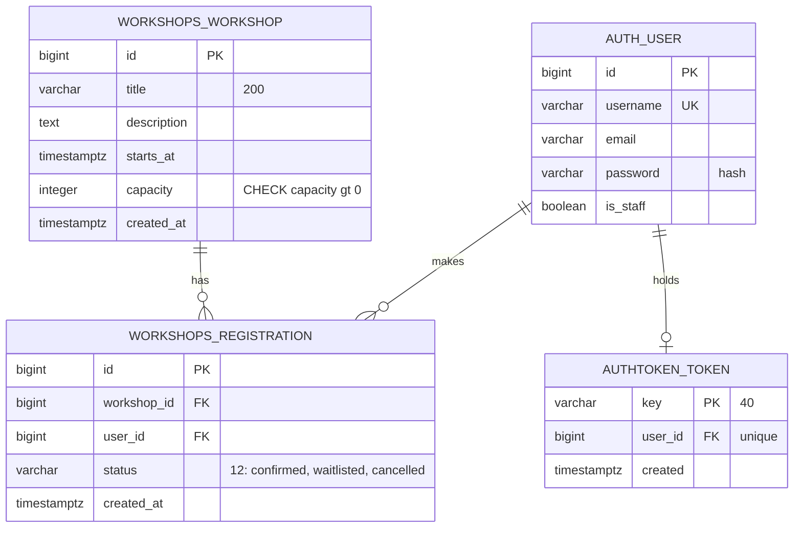
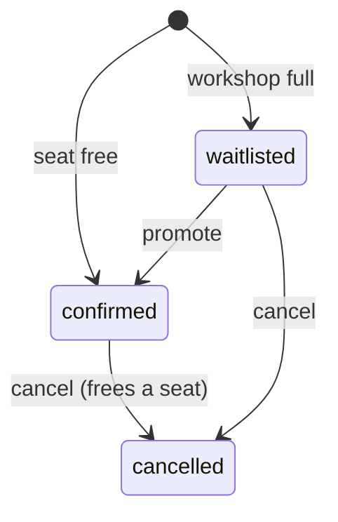
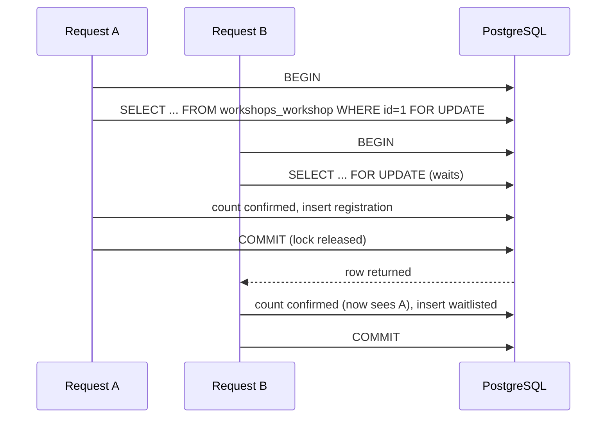

# Backend Schema

| | |
|---|---|
| Version | 1.0, issued 2026-10-23 |
| Owner | Massimo Selvi (tech lead) |
| Source of truth | `backend/infrastructure/db/models.py` and `migrations/0001_initial.py` |
| Related | [Technical requirements](02-technical-requirements.md), [Architecture guide](../architecture.md), [ADR 0001](../architecture/adr/0001-row-locks-for-seat-allocation.md) |

The tables below are written from the models and the migration. The SQL is what Django generates for PostgreSQL; the names of auto-created indexes are shortened. The ORM app label is `workshops`, so the tables are `workshops_workshop` and `workshops_registration`. Do not rename the label: tables, migrations and queued messages depend on it.

## 1. Entity-relationship diagram



## 2. Tables

### workshops_workshop

| Column | Type | Null | Notes |
|--------|------|:----:|-------|
| id | bigint, identity | no | Primary key |
| title | varchar(200) | no | |
| description | text | no | Empty string by default |
| starts_at | timestamptz | no | |
| capacity | integer | no | Django adds `CHECK (capacity >= 0)` for the positive field, and the model adds a stricter one |
| created_at | timestamptz | no | Set on insert |

Constraint `workshop_capacity_positive`: `CHECK (capacity > 0)`.
Default order: `starts_at`, then `id` in the list queries.

### workshops_registration

| Column | Type | Null | Notes |
|--------|------|:----:|-------|
| id | bigint, identity | no | Primary key |
| workshop_id | bigint | no | FK to `workshops_workshop`, `ON DELETE CASCADE`, indexed |
| user_id | bigint | no | FK to `auth_user`, `ON DELETE CASCADE`, indexed |
| status | varchar(12) | no | `confirmed`, `waitlisted` or `cancelled`. Default `confirmed`. **Not constrained in the database.** |
| created_at | timestamptz | no | Set on insert. Orders the waitlist. |

```sql
CREATE UNIQUE INDEX one_active_registration_per_user
    ON workshops_registration (workshop_id, user_id)
    WHERE status IN ('confirmed', 'waitlisted');
```

The partial unique index allows a user to register again after cancelling. History is kept as `cancelled` rows.

### authtoken_token (Django REST framework)

One row per user, `user_id` unique. The key is the token. Logout deletes the row. Issue #57 changes this to expiring tokens, one per device.

## 3. Status machine



The rules live in `domain/workshops/entities.py`:

- `cancel()` returns true only when a **confirmed** seat was freed. Cancelling a cancelled registration changes nothing.
- `promote()` works only on a waitlisted registration, otherwise it raises `InvalidStatusTransition`.
- `confirmed` and `waitlisted` are **active**.
- The ORM `Registration.Status` and the domain `RegistrationStatus` must have the same values. `tests/test_status_mapping.py` fails if they differ.

## 4. Locking and consistency



| Rule | Where it is enforced |
|------|----------------------|
| Seat counts are read only after the workshop row is locked | `WorkshopRepository.lock`, use cases; `test_seat_counts_are_only_read_under_the_workshop_lock` |
| One lock per workshop. Other workshops are not blocked. | Row lock, not a table lock |
| Two active registrations of one user in one workshop are impossible | Partial unique index |
| Capacity is positive | Check constraint |
| Confirmed rows never exceed capacity | The lock, **not the database** (see finding F3) |

Isolation level is the PostgreSQL default, read committed. It is enough because every write path takes the row lock first.

## 5. Findings

<a id="5-findings"></a>

These come from reading the schema against its rules. None is a bug that oversells a seat today. Each is a gap between what the code guarantees and what the database would also guarantee.

| ID | Finding | Effect | Severity | Proposal |
|----|---------|--------|:--------:|----------|
| F1 | `status` has no `CHECK` constraint. | A write outside the ORM (admin shell, SQL) can store a value such as `Confirmed ` that no query counts. The domain test guards the enum in code only. | Medium | Add `CHECK (status IN ('confirmed','waitlisted','cancelled'))`. Package D2. |
| F2 | Capacity has two checks: `>= 0` from the field type and `> 0` from the model. | None. The first is redundant. | Low | Leave. Note it so nobody removes the stricter one. |
| F3 | The database does not cap confirmed rows at capacity. | A write that skips the use case (R6) can oversell. Only the alarm (#46) would notice. | Medium | Keep the lock rule. Add the oversold-seats alarm (#46). A trigger or a counter column is possible, and costs write complexity. Record the choice in an ADR if taken. |
| F4 | No composite index for the common queries: count confirmed per workshop, oldest waitlisted per workshop. | At this size the `workshop_id` index is enough. With many registrations per workshop a scan grows. | Low | Add `(workshop_id, status, created_at, id)` when a measurement justifies it. |
| F5 | The list query counts registrations with a join over all rows of each workshop. | Cost grows with history, as `cancelled` rows stay. The 30 s cache hides it. | Low | Measure on AWS (#43). If needed, count only active rows or keep a counter under the lock. |
| F6 | Registration rows are deleted with the user (`ON DELETE CASCADE`). | A deleted account removes its history and changes past counts. | Low | Acceptable for a demo. A real service would anonymize instead. |
| F7 | Tokens do not expire. One token per user. | Stolen token works forever. | Medium | Issue #57. |

Candidate issues: **F1** (#85, D2), **F3** (covered by #46). F4 to F6 are recorded here and wait for a measurement or a decision.

## 6. API surface

All paths are under `/api/`. Auth is `Authorization: Token <key>`.

| Method and path | Auth | Throttle | Purpose |
|-----------------|------|----------|---------|
| `GET health/` | none | none | Load balancer check |
| `POST auth/signup/` | none | `auth` 10/min | Create a user, return token |
| `POST auth/login/` | none | `login` 10/min | Return token |
| `POST auth/logout/` | token | user | Delete the token |
| `GET auth/me/` | token | user | Current user |
| `GET workshops/` | none | anon 60/min | Paginated list (20), cached 30 s |
| `GET workshops/{id}/` | none | anon 60/min | One workshop |
| `POST workshops/{id}/register/` | token | `registration` 10/min | Register or waitlist, idempotent |
| `GET registrations/` | token | user 120/min | My registrations |
| `POST registrations/{id}/cancel/` | token | `registration` 10/min | Cancel mine, promotes the oldest waiting |
| `GET organizer/workshops/` | staff | user | Seats taken, waitlist size |
| `GET organizer/workshops/{id}/registrations/` | staff | user | Who is registered |

## 7. Access patterns

| Pattern | Query | Index used |
|---------|-------|------------|
| Lock a workshop | `SELECT ... WHERE id = ? FOR UPDATE` | Primary key |
| Active registration of a user | `WHERE workshop_id = ? AND user_id = ? AND status IN (active)` | Partial unique index |
| Count confirmed | `WHERE workshop_id = ? AND status = 'confirmed'` | `workshop_id` FK index |
| Oldest waitlisted | `WHERE workshop_id = ? AND status = 'waitlisted' ORDER BY created_at, id LIMIT n` | `workshop_id` FK index, then sort |
| My registrations | `WHERE user_id = ?` | `user_id` FK index |
| Workshop list with seats | `GROUP BY workshop`, count confirmed | Scan of registrations (F5) |

## 8. Migrations

| Migration | Content |
|-----------|---------|
| `0001_initial` | `Workshop`, `Registration`, both constraints |

Rules: `makemigrations --check --dry-run` runs in CI. A migration that adds a `CHECK` on a populated table needs a validation step. Run it as `NOT VALID` then `VALIDATE`, in two migrations.
