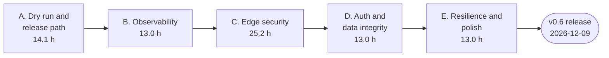
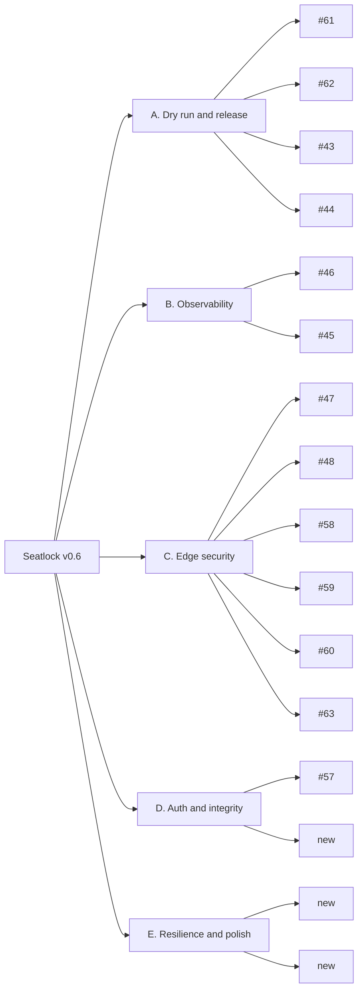

# Implementation Plan

| | |
|---|---|
| Version | 1.0, issued 2026-10-23 |
| Owner | Massimo Selvi |
| Related | [Charter](../pm/01-project-charter.md), [Schedule baseline](../pm/03-estimates-and-schedule-baseline.md), [Technical requirements](02-technical-requirements.md) |

This plan says **what is built, in what order, and how we know it is done**. Hours and dates are in the [baseline](../pm/03-estimates-and-schedule-baseline.md). This document does not repeat them.

## 1. Approach

- Small pull requests, one purpose each. `main` stays releasable.
- The risky and blocking work goes first. Today that is the AWS dry run (#43): other cloud work depends on what it finds.
- Decisions that are hard to reverse get an ADR before code.
- Each phase ends with a milestone and an exit check.

## 2. Phases delivered

| Phase | Milestone | Content | Pull requests |
|-------|-----------|---------|--------------|
| 1 | v0.1 Foundation | Toolchain, Django scaffold, models and constraints, seat services, workshops API, Compose stack, workshop list UI, CI, ADRs 0001 and 0002 | #20 to #31 |
| 2 | v0.2 Registration | Accounts, register and cancel, registration UI | #32 to #34 |
| 3 | v0.3 Operations | Organizer dashboard (API and UI), rate limiting and caching, SLOs and runbooks | #35 to #38 |
| 4 | v0.4 Deploy | ADRs 0003 and 0004, CDK stacks, deploy and rollback guide | #39 to #42 |
| 5 | v0.5 Security | Login limit, fail-closed settings, cache key, `/admin` off, non-root container, CI token | #65 to #70 |
| Extra | n/a | Cost analysis, Clean Architecture, UnoCSS frontend, load test and CI job, ALB lock and tags, preflight script, C4 model | #71 to #83, [change log](../pm/05-change-request-log.md) |

## 3. Phases ahead (milestone v0.6 Hardening)

| Phase | Packages | Issues | Exit check |
|-------|----------|--------|------------|
| A. Dry run and release path | A1 ports to localhost. A2 pin Actions, Dependabot. A3 AWS dry run. A4 release workflow with OIDC. | #61, #62, #43, #44 | The deploy guide ran on a real account, was corrected, and the account was destroyed. The release workflow pushed an image. |
| B. Observability | B1 oversold-seats check and alarm. B2 queue backlog alarm. | #46, #45 | Both alarms fire in a test on a real stack. |
| C. Edge security | C1 HTTPS to the ALB. C2 explicit hosts. C3 headers and CSP. C4 WAF. C5 Redis auth token. C6 access logs. | #47, #48, #58, #59, #60, #63 | The stack passes a header scan. No path reaches the ALB except through CloudFront. |
| D. Auth and data integrity | D1 expiring tokens, one per device, with an ADR. D2 `CHECK` on `status`. | #57, new | Expired tokens are refused. The database rejects a bad status. |
| E. Resilience and polish | E1 sweep for lost promotions and emails. E2 screenshots, load test on AWS, demo notes. | new, new | A killed worker loses no promotion. The README shows the AWS result. |

## 4. Work breakdown

## 5. Dependencies and order

| Dependency | Why | Effect if late |
|------------|-----|----------------|
| Sandbox login before A3 | The dry run needs a signed-in session | Phase A cannot finish; B, C and E2 wait for real-stack checks |
| Domain name before C1 | A certificate needs a domain | Drop the HTTPS hop to the ALB from v0.6 and record it in a change request |
| ADR before D1 | Cookies versus header changes the API | D1 slips |
| D2 migration | A `CHECK` on a table with data needs two steps | Use `NOT VALID`, then `VALIDATE` |

## 6. Dry run gates (A3)

The dry run follows [deploy.md](../deploy.md). Every gate needs an explicit go from the owner.

| Gate | Check | Stop when |
|------|-------|-----------|
| 1. Preflight | `infra/scripts/preflight.sh` (read-only) | Any check fails |
| 2. Budget | A budget of 10 USD with an email alert exists, before any resource | No budget |
| 3. Bootstrap | CDK bootstrap in the sandbox account | Errors |
| 4. Deploy | `cdk diff` reviewed, then deploy | The diff shows anything unexpected |
| 5. Verify | Health, register, cancel, promotion, load test | A seat is oversold |
| 6. Drill | One runbook exercise | The runbook is wrong: fix it |
| 7. Destroy | Destroy all stacks, check nothing is left by tag `DestroyBy` | Resources remain |

## 7. Definition of done

A package is done when:

1. The pull request is merged and all checks are green.
2. A test fails if the behavior breaks. Infra changes include the `cdk diff`.
3. A change to architecture has an ADR. A change to a flow updates [App flow](03-app-flow.md).
4. The issue is closed with the pull request linked.
5. The [status report](../pm/04-weekly-status-report.md) lists it.

A phase is done when its exit check in section 3 holds.

## 8. Rollout

| Environment | Use | Rule |
|-------------|-----|------|
| Local (Compose) | Development and the load test | `docker compose up --build` |
| CI | Every pull request | Checks, and the load test when domain, application or infrastructure change |
| AWS sandbox | The dry run, then destroyed | Gates in section 6; budget 10 USD |
| Public demo | Showing the project | **Not before phase C.** Fake data only. Needs an answer to PRD question Q1. |

Rollback: for code, revert the pull request. For the cloud, follow the rollback part of [deploy.md](../deploy.md).

## 9. Risks for the plan

See the [charter](../pm/01-project-charter.md#8-risks): R1 (dry run defects), R2 (cost), R3 (capacity), R5 (public link too early), R6 (bypass of the lock).

## 10. Follow-up work not in v0.6

| Item | Source |
|------|--------|
| Create workshops in the app | PRD Q1 |
| Waitlist position | PRD Q2 |
| Accessibility audit with an automated tool | [UX brief](04-ux-design-brief.md#10-known-gaps) |
| Composite index and list counting | [Schema findings](05-backend-schema.md#5-findings) F4, F5 |
