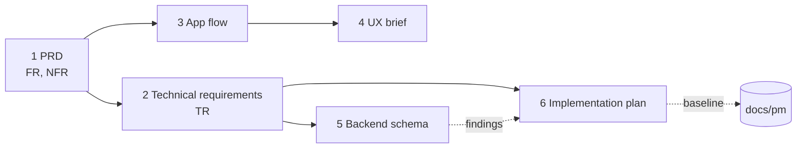

# Product and technical documents

Six documents define what Seatlock is, how it must behave and how it is built. They are written for readers of the repository and for the next person who changes it. The project management side is in [docs/pm/](../pm/README.md).

| # | Document | Question it answers |
|---|----------|---------------------|
| 1 | [Product Requirements Document](01-prd.md) | What does the product do, for whom, and how do we know? |
| 2 | [Technical Requirements Document](02-technical-requirements.md) | What must the system satisfy, and which check proves it? |
| 3 | [App Flow](03-app-flow.md) | How does a person move through the app, including errors? |
| 4 | [UI/UX Design Brief](04-ux-design-brief.md) | How should it look and feel, and what are the rules? |
| 5 | [Backend Schema](05-backend-schema.md) | What is in the database, and where are its gaps? |
| 6 | [Implementation Plan](06-implementation-plan.md) | In what order is the remaining work done? |

## How they connect

Requirement IDs (`FR-`, `NFR-`, `TR-`) are stable. A requirement without an ID is not planned. The PRD links each Must requirement to a test.

## Rules

- A change to a flow, a contract or the schema updates the matching document in the **same pull request**.
- Numbers come from a command or a test, not from memory.
- Open questions stay visible in the PRD (section 12) until a decision closes them.

`img/` holds the screenshots used in the UX brief. They come from the built frontend with a mocked API and hold sample data only.
